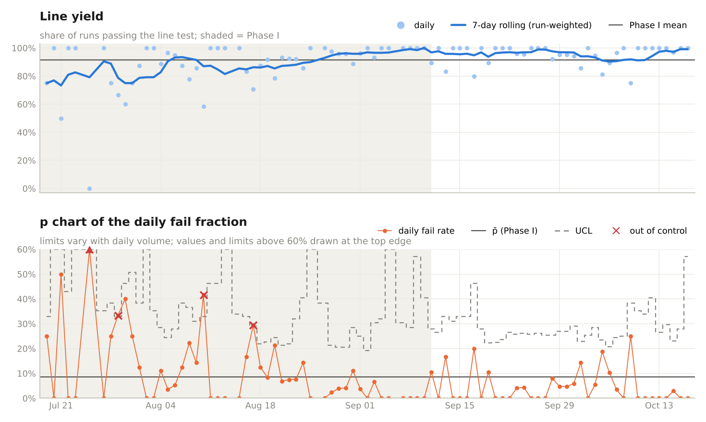
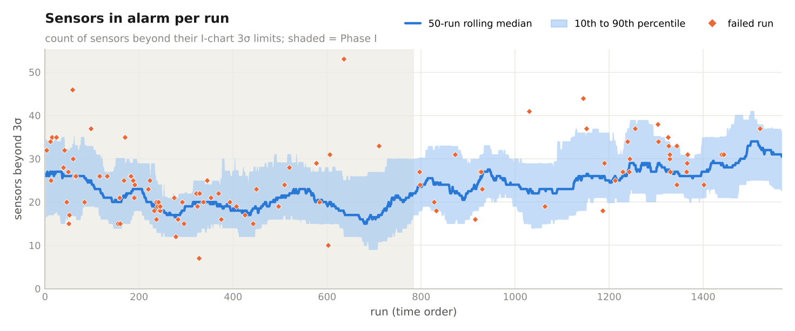
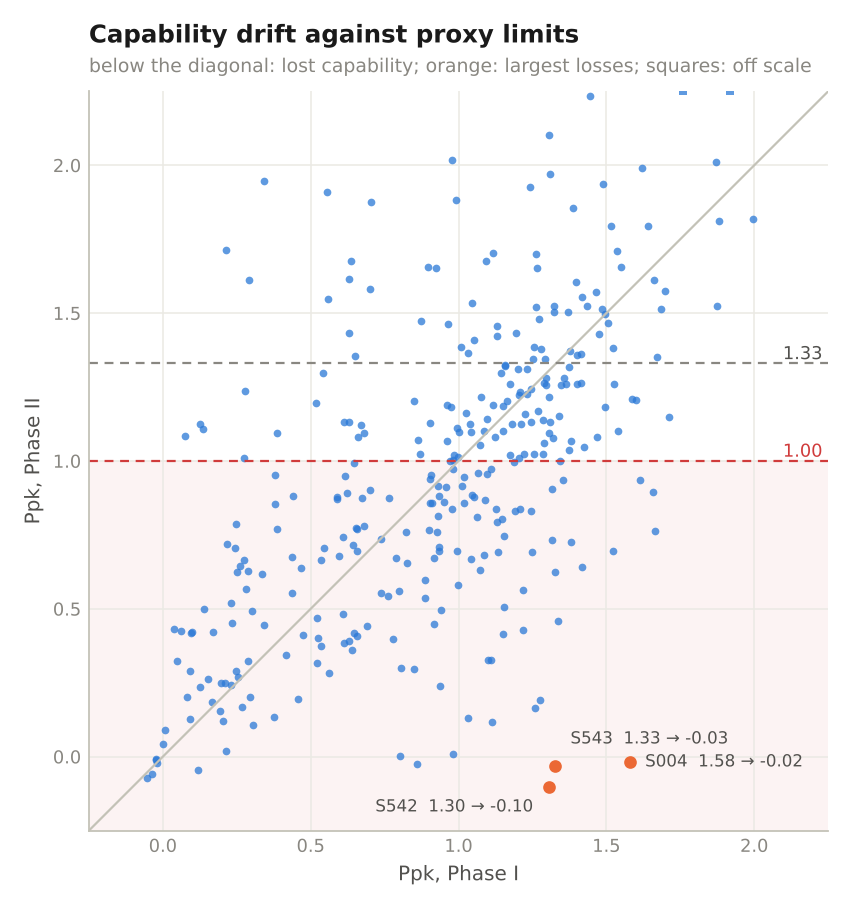

# Statistical Process Control and Failure Analysis of the UCI SECOM Semiconductor Dataset

[](https://github.com/Shim-1122/secom-spc/actions/workflows/ci.yml)

Shyam Iyer, Rutgers University

## Abstract

SECOM records 590 in-line sensor and metrology signals for 1567 production runs of a semiconductor fab between July and October 2008. Each run has a pass/fail outcome from a downstream line test. This repository applies univariate and multivariate statistical process control (SPC) to the data and asks which sensors are associated with failure. Control limits, sensor screening and models are fitted only on earlier runs and evaluated on later ones.

The dominant feature of the data is a process change between the first and second halves of the record. A classifier separates the two halves with a cross-validated AUC of 0.999, 168 of 324 retained sensors shift (Kolmogorov-Smirnov p < 1e-6), and three sensors report a constant value from the start of the record until early September. Line yield rose from 91.5 % to 95.3 % across the same boundary. A PCA-based squared prediction error (SPE) chart detects the change immediately, and contribution analysis attributes it to the sensors that changed regime. Several sensors separate failing from passing runs in the training period, but most of this association does not survive a test on later runs or a comparison restricted to runs from the same week. Classifiers that reach ROC AUC 0.70 to 0.77 under shuffled cross-validation, the protocol used in most published SECOM results, reach only 0.53 to 0.56 on a temporal hold-out.

## Contents

1. [Introduction](#1-introduction)
2. [Data](#2-data)
3. [Methods](#3-methods)
4. [Results](#4-results)
5. [Discussion](#5-discussion)
6. [Limitations](#6-limitations)
7. [Reproducing the analysis](#7-reproducing-the-analysis)
8. [References](#references)

## 1. Introduction

A semiconductor line generates far more process measurements than an engineer can inspect, and only a small fraction of runs fail. Two questions follow. The monitoring question asks which runs, and which sensors, departed from a reference period. The diagnostic question asks which sensors carry information about failure. SECOM, donated to the UCI Machine Learning Repository by McCann and Johnston (2008), is one of the few public datasets that allows both questions to be studied on production data.

Most published work on SECOM treats it as a static feature-selection or classification benchmark and evaluates with shuffled cross-validation. The runs are time-stamped, however, and fab processes are not stationary. This project therefore treats time as the primary axis. Phase I (the first half of the record) is used to fit control limits and models; Phase II (the second half) is monitored with those limits frozen, as it would be in a fab. The same principle governs the predictive analysis.

## 2. Data

All figures below were obtained by loading the raw files; none are taken from the dataset description.

| Property | Value |
|---|---|
| Runs | 1567 (one row per production entity) |
| Sensors | 590 anonymised signals. UCI lists 591 attributes; the extra one is the label. |
| Outcome | 104 fails (6.64 %), 1463 passes |
| Period | 2008-07-19 11:55 to 2008-10-17 06:07, 86 production days, stored in time order |
| Missing values | 4.54 % of sensor cells |
| Units, sensor names, specification limits | not published |

Sensors were screened using Phase I data only. Twenty-four were missing in more than half of the runs, 122 were constant or nearly constant, and 120 were near-duplicates of an earlier sensor (absolute Pearson correlation above 0.98). The remaining 324 sensors are used throughout.

Table 1. Time-based partitions.

| Partition | Runs | Fails | Role |
|---|---|---|---|
| Phase I (to 2008-09-11) | 784 | 67 | Control limits (from its 717 passing runs), screening, imputation, PCA model |
| Phase II | 783 | 37 | Monitoring with frozen limits |
| Training (first 70 %) | 1097 | 78 | Sensor ranking, model fitting, threshold selection |
| Test (last 30 %, from 2008-09-26) | 470 | 26 | Hold-out evaluation |

## 3. Methods

Formulas, constants and references for every step are given in [docs/methodology.md](docs/methodology.md). The essentials are summarised here.

**Univariate SPC.** Each sensor receives an individuals and moving-range (I-MR) chart. The centre line and within-run sigma (MR-bar / d2) are estimated from the passing runs of Phase I, after up to three rounds of removing points beyond 3 sigma. All eight Nelson run rules are evaluated. For the top-ranked sensors, X-bar/S charts on subgroups of five consecutive runs, an EWMA chart (lambda = 0.2, L = 2.86) and a tabular CUSUM (k = 0.5 sigma, h = 5 sigma) are also produced.

**Yield monitoring.** The daily fail fraction is plotted on a p chart with variable limits. Because daily fail counts are often more variable than a binomial model allows, a Laney p' chart is computed as well.

**Capability.** SECOM publishes no specification limits, so true Cpk cannot be computed. Each sensor is given proxy limits at its Phase I median plus or minus four robust standard deviations (1.4826 times the MAD). A stable, normally distributed sensor would then have Cpk near 1.33. Cp, Cpk, Pp, Ppk and a percentile-based Cpk that does not assume normality are reported for each phase. The quantity of interest is the change between phases, not the absolute value.

**Multivariate SPC.** Sensors are standardised with Phase I reference statistics and projected onto the principal components that explain 80 % of reference variance. Hotelling's T² measures variation within that subspace, and SPE (the Q statistic) measures variation outside it. Parametric 99 % limits (F distribution for T², Box's scaled chi-square approximation for SPE) are reported alongside empirical limits equal to the 99th percentile of the reference statistic. The empirical limits are used for all alarm rates in Section 4 unless stated otherwise. SPE contributions identify the sensors behind an alarm.

**Drift diagnostics.** Each sensor's Phase I and Phase II distributions are compared with a two-sample Kolmogorov-Smirnov test. In adversarial validation, a random forest is trained to predict the phase of a run; a cross-validated AUC near 1 indicates that the two periods are easily distinguished. A sensor is flagged as "frozen, then live" if it reports a single value for at least two complete weeks and later varies. Finally, the multivariate monitor is refitted without the drifting sensors to measure how much of the Phase II alarm rate they explain.

**Ranking failure-related sensors.** Five criteria are computed on the training partition: the Mann-Whitney U test with Benjamini-Hochberg correction, univariate ROC AUC, mutual information, L1-logistic stability selection over 200 class-balanced half-samples, and Extra-Trees importance. The consensus rank orders sensors by their mean rank across the five criteria. Two further checks test whether an association is genuine. The first is the AUC on the later test partition. The second is a within-week AUC, which compares failing runs only with passing runs from the same calendar week and so removes associations produced by a shared time trend. An SPC-specific measure, alarm lift, gives the fail rate among runs in which a sensor's I chart signalled, divided by the overall fail rate.

**Failure prediction.** Four classifiers are compared: an L1-penalised logistic regression on all sensors, a logistic regression on the 20 sensors with the highest univariate AUC (selected inside each cross-validation fold), a random forest and histogram gradient boosting. Preprocessing is refitted within every fold. Three model-free scores serve as baselines: the number of sensors beyond 3 sigma, T² and SPE. The decision threshold minimises the balanced error rate (BER) on out-of-fold training predictions and is then fixed. Performance is reported under three protocols: the temporal hold-out; walk-forward evaluation, in which each block of 100 Phase II runs is scored by a model retrained on all earlier runs; and shuffled stratified 10-fold cross-validation, included for comparison with the literature.

## 4. Results

### 4.1 Yield

Yield over the whole record is 93.4 %. It rises from 91.5 % in Phase I to 95.3 % in Phase II (Figure 1). Using the Phase I fail fraction of 8.6 % as the centre line, the p chart flags four days in July and August. The day-to-day variation exceeds the binomial expectation (Laney sigma_z = 1.19), and after the Laney correction one of the four days remains out of control.


*Figure 1. Daily and seven-day rolling yield (top) and p chart of the daily fail fraction with limits that vary with daily volume (bottom). The dotted line marks the end of Phase I.*

### 4.2 Univariate control charts

Charting each sensor separately is not workable at this scale. With limits from Phase I, the median sensor exceeds 3 sigma on 2.9 % of Phase I runs and 2.4 % of Phase II runs, roughly ten times the nominal 0.27 %. Every run has at least one sensor beyond 3 sigma; the median is 23 sensors per run (Figure 2). Failing runs average 25.4 such sensors against 23.7 for passing runs. Two properties of the data explain the excess. Most sensors are heavy-tailed: only 1.2 % pass a D'Agostino-Pearson normality test at the 5 % level. The moving-range estimator also understates the spread of such sensors.


*Figure 2. Number of sensors beyond their 3-sigma I-chart limits in each run: 50-run rolling median with 10th to 90th percentile band, and individual failed runs.*

Sensor S059, the top-ranked sensor in Section 4.6, illustrates a regime change within Phase I. Its readings are high and variable for the first 480 or so runs, where many of the early failures occur, and fall into a narrow band afterwards (Figure 3).


*Figure 3. I-MR chart for S059. Crosses mark points beyond 3 sigma, open circles mark other Nelson rule violations, triangles mark values beyond the plotted range, and the strip between the panels marks failed runs.*

The corresponding X-bar/S chart and I-MR charts for the five next-ranked sensors are in [reports/figures](reports/figures).

### 4.3 Capability

Against the proxy limits, the median Ppk is 1.00 in Phase I and 0.95 in Phase II. A Phase I median below the nominal 1.33 is expected for heavy-tailed sensors, because the overall standard deviation includes the tails that the MAD excludes. In Phase II, 21.6 % of sensors have Ppk of at least 1.33 and 52.5 % have Ppk below 1.0. The largest degradation is in S542, whose Ppk falls from 1.31 to -0.10: its mean shifts by 5.7 Phase I standard deviations and its spread increases 5.7-fold (Figure 4).


*Figure 4. Ppk in Phase II against Ppk in Phase I. Points below the diagonal lost capability relative to their own baseline.*

### 4.4 Multivariate control charts

Eighty-five principal components are needed to explain 80 % of the reference variance, so the sensors are only weakly correlated. The parametric T² limit assumes multivariate normality and is exceeded by 8.5 % of the reference runs themselves. Under the empirical limit, T² signals on 0.9 % of Phase II runs, close to the nominal 1 %. SPE behaves very differently: it signals on 83.5 % of Phase II runs, and the increase begins at the start of Phase II (Figure 5). Within Phase I the SPE chart is informative about failure: 15 of the 23 Phase I runs above the SPE limit failed (65 %), against a Phase I fail rate of 8.5 %.


*Figure 5. Hotelling T² and SPE for every run, log scale. The solid red line is the empirical 99 % limit used for alarms; the dashed line is the parametric limit.*

The SPE contribution plot for the failing Phase II run with the largest SPE (run 1152) ranks S542 first (Figure 6). Refitting the monitor without the drifting sensors shows that a small number of them account for most of the Phase II alarms (Table 2).


*Figure 6. Share of SPE contributed by each of the top eight sensors for run 1152.*

Table 2. Phase II alarm rates after removing drifting sensors (empirical 99 % limits).

| Sensors included | Number | PCs | T² alarms | SPE alarms |
|---|---|---|---|---|
| All retained | 324 | 85 | 0.9 % | 83.5 % |
| Excluding the six frozen-then-live sensors | 318 | 84 | 0.6 % | 31.7 % |
| Excluding the 20 sensors with largest KS statistic | 304 | 82 | 0.9 % | 18.5 % |
| Excluding all sensors with KS p < 1e-6 | 156 | 56 | 1.3 % | 7.9 % |

### 4.5 Process drift

The two phases are almost perfectly separable (adversarial-validation AUC 0.999), and 168 sensors differ between them at KS p < 1e-6. The largest KS statistics belong to S542 (0.74), S078 (0.74), S543 (0.72) and S544 (0.61). Six sensors fit the frozen-then-live pattern. S114, S249 and S521 begin to vary in the week of 18 August; S542, S543 and S544 begin in the week of 1 September, shortly before the Phase I boundary (Figure 7). A long run of identical readings usually indicates a held or stale value rather than an unusually stable process. Control limits fitted to such a stretch have no meaning once the sensor begins reporting.


*Figure 7. Weekly median and 10th to 90th percentile band for the sensors that changed most between phases.*

### 4.6 Sensors associated with failure

On the training partition, 17 sensors differ between failing and passing runs at a false discovery rate of 5 % (24 at 10 %). The five ranking criteria agree poorly: pairwise Spearman correlations between their rankings range from 0.10 to 0.98. Table 3 lists the highest-ranked sensors with the two out-of-sample checks. An AUC below 0.5 means the sensor reads lower in failing runs.

Table 3. Top-ranked sensors and robustness checks.

| Sensor | Rank | Training AUC | Within-week AUC | Test AUC | FDR q | Alarm lift (Fisher p) | Assessment |
|---|---|---|---|---|---|---|---|
| S059 | 1 | 0.756 | 0.645 | 0.473 | < 0.001 | 2.1 (< 0.001) | Association confined to the early regime |
| S129 | 2 | 0.603 | 0.511 | 0.612 | 0.047 | 0.4 (1.0) | No within-week association |
| S028 | 3 | 0.374 | 0.476 | 0.428 | 0.011 | 0.5 (0.98) | Weak within week |
| S247 | 4 | 0.672 | 0.564 | 0.562 | < 0.001 | 2.4 (< 0.001) | Consistent on all checks |
| S033 | 5 | 0.615 | 0.564 | 0.584 | 0.021 | 1.6 (0.25) | Consistent on all checks |
| S122 | 6 | 0.395 | 0.462 | 0.443 | 0.046 | 1.2 (0.04) | Weak within week |
| S021 | 8 | 0.613 | 0.619 | 0.580 | 0.024 | 3.1 (0.009) | Consistent on all checks |
| S103 | 10 | 0.647 | 0.494 | 0.715 | 0.001 | 1.5 (0.15) | No within-week association in training |

S059 is the clearest example of an association that does not transfer. Its training AUC of 0.76 falls to 0.47 on the test partition, because the regime in which it separated the classes ended (Figure 3). Only S021, S247 and S033 keep the same direction under every check, and S021 and S247 are also over-represented in I-chart alarms on failing runs. Figure 8 compares pooled and within-week AUC for the top 40 sensors.


*Figure 8. Training AUC against within-week AUC. Sensors near the dashed line retain their association within a week; sensors near 0.5 on the vertical axis owe their pooled AUC to a time trend.*

The consensus ranking, the per-criterion ranks and pass/fail distributions of the top nine sensors are in [reports/figures](reports/figures) (files 03 to 04).

### 4.7 Failure prediction

Table 4 reports the temporal hold-out. The test partition contains 470 runs and 26 failures, a base rate of 5.5 %.

Table 4. Temporal hold-out performance. Cross-validated AUC on the training partition is shown for reference.

| Model | Training CV AUC | Test AUC (95 % CI) | Test PR AUC | Test BER | Recall | Specificity |
|---|---|---|---|---|---|---|
| L1 logistic, all sensors | 0.744 | 0.532 (0.42 to 0.64) | 0.068 | 0.494 | 0.23 | 0.78 |
| Logistic, top 20 sensors | 0.661 | 0.563 (0.44 to 0.68) | 0.097 | 0.423 | 0.35 | 0.81 |
| Random forest | 0.773 | 0.536 (0.42 to 0.65) | 0.064 | 0.503 | 0.04 | 0.96 |
| Gradient boosting | 0.763 | 0.545 (0.44 to 0.65) | 0.060 | 0.516 | 0.12 | 0.85 |
| Baseline: sensors beyond 3 sigma | 0.562 | 0.650 (0.55 to 0.75) | 0.083 | 0.399 | 0.88 | 0.32 |
| Baseline: Hotelling T² | 0.458 | 0.454 (0.32 to 0.59) | 0.062 | 0.541 | 0.62 | 0.30 |
| Baseline: SPE | 0.674 | 0.481 (0.36 to 0.60) | 0.057 | 0.500 | 1.00 | 0.00 |

Every classifier loses most of its discrimination between training and test, and every test confidence interval includes 0.5. The count of sensors beyond 3 sigma is the only score whose interval excludes 0.5. Its training AUC is only 0.56, though, so this result may not be stable. SPE discriminates in training (0.67) but not in test, consistent with Section 4.4: after the process change nearly every run exceeds the SPE limit.


*Figure 9. ROC and precision-recall curves on the temporal hold-out.*

Under shuffled 10-fold cross-validation the same classifiers reach ROC AUC 0.70 to 0.77 and PR AUC 0.14 to 0.19, with BER of 0.29 to 0.32 (optimistic, since the threshold is tuned on the same predictions). These figures are close to the baseline published with the dataset, in which a kernel ridge classifier on 40 selected sensors achieved BER between 33.5 % and 40.1 % under 10-fold cross-validation (McCann and Johnston, 2008). The gap between the two protocols is the main predictive result of this study.

Walk-forward retraining recovers part of the signal for the linear models (Table 5, Figure 10). Over the 783 Phase II runs (37 failures), retraining every 100 runs raises the pooled AUC of the L1 logistic regression from 0.50 to 0.61 (0.52 to 0.70). Gradient boosting trained once on Phase I scores 0.64 (0.56 to 0.73) and does not improve with retraining.

Table 5. Walk-forward evaluation over Phase II (pooled ROC AUC).

| Model | Trained once | Retrained every 100 runs | Retrained on last 500 runs |
|---|---|---|---|
| Logistic, top 20 sensors | 0.453 | 0.556 | 0.519 |
| L1 logistic, all sensors | 0.500 | 0.611 | |
| Gradient boosting | 0.642 | 0.602 | |


*Figure 10. Pooled walk-forward AUC for models trained once versus retrained before each block.*

## 5. Discussion

The analysis is shaped by a process change near the Phase I/Phase II boundary. Several pieces of evidence point to it: the near-perfect adversarial-validation AUC, the onset of SPE alarms, the six frozen-then-live sensors, and a concurrent rise in yield. The data cannot say whether the change was a maintenance event, a recipe adjustment or new instrumentation coming online. Its practical consequences are clear, however. Limits and models fitted on Phase I describe a process that no longer exists in Phase II.

For monitoring, the results support standard practice. Per-sensor Shewhart charts generate an alarm on every run and are not usable alone at this dimensionality. A PCA-based monitor reduces the problem to two statistics, but its limits should be set empirically when the sensors are far from normal. Re-baselining is required after a known change, and sensors whose data quality changed should be removed beforehand. The contribution analysis identified the responsible sensors directly, which is the step that would lead an engineer to the cause.

For diagnosis, the results caution against reading a ranked list of "predictive" sensors at face value. Strong training-period associations, including the strongest one (S059), were explained by time: both the sensor and the fail rate changed over the record. Restricting comparisons to the same week, and testing on a later period, removed most of them. S021, S247 and S033 remain as candidates for engineering follow-up. With 104 failures in total, even these associations are modest.

For prediction, shuffled cross-validation overstated achievable performance by roughly 0.2 AUC on this dataset. Evaluating on later data, and retraining on a schedule, gives a more realistic picture of how a yield model would perform in production.

## 6. Limitations

Sensor identities and units are unknown, so no physical interpretation is possible and capability is computed against proxy limits. The data contain 104 failures, of which 26 fall in the test partition and 37 in the walk-forward period; confidence intervals are correspondingly wide, and differences of a few hundredths in AUC are not meaningful. The outcome comes from a downstream test that may depend on steps not represented in these signals. Runs are treated as independent, although autocorrelation is likely and would raise univariate alarm rates. The Phase I/II boundary is a fixed fraction of the record rather than a known process event. Finally, the Spotfire dashboard is specified in [docs/spotfire_dashboard.md](docs/spotfire_dashboard.md) but not included as a built file, and the JMP script in [jmp/secom_spc.jsl](jmp/secom_spc.jsl) has not been executed in JMP as part of continuous integration.

## 7. Reproducing the analysis

Python 3.10 or later is required. The raw data are included in `data/raw/`.

```bash
git clone https://github.com/Shim-1122/secom-spc.git
cd secom-spc
python -m pip install -e ".[dev]"
python -m secom_spc.pipeline          # full analysis, about 8 minutes
python -m secom_spc.pipeline --fast   # reduced bootstrap; no shuffled CV; about 2 minutes
pytest                                # 35 unit tests
```

Every number in this document is written to `reports/summary.json` by the pipeline. All parameters (partition sizes, chart constants, proxy specification width, PCA variance target, model settings) are defined in [src/secom_spc/config.py](src/secom_spc/config.py). The UCI files can be re-downloaded with `python scripts/download_data.py --force`.

### Repository structure

```text
src/secom_spc/
  config.py         analysis parameters
  data.py           loading, time ordering, partitions
  preprocess.py     sensor screening and imputation (fitted on Phase I)
  spc.py            I-MR, X-bar/S, p, Laney p', EWMA and CUSUM charts
  rules.py          Nelson rules 1 to 8
  capability.py     Cp, Cpk, Pp, Ppk and percentile Cpk
  multivariate.py   PCA monitoring: Hotelling T², SPE, contributions
  drift.py          KS tests, adversarial validation, frozen sensors, within-week AUC
  features.py       sensor ranking criteria and consensus
  modeling.py       classifiers and the three evaluation protocols
  plots.py          figures
  pipeline.py       end-to-end analysis, one function per stage
tests/              unit tests for constants, run rules, capability, MSPC, leakage and confounding
docs/               methodology and Spotfire dashboard specification
jmp/                JMP script that rebuilds the charts from the exports
reports/            figures, tables, dashboard exports and summary.json
data/raw/           the original UCI files
```

### Outputs for dashboards

`reports/exports/` contains tidy CSV files intended for Spotfire, JMP or a spreadsheet:

| File | One row per | Contents |
|---|---|---|
| `runs.csv` | run | outcome, phase, alarm counts, T², SPE, limits, alarm flags, predicted fail probability |
| `daily_kpi.csv` | day | runs, fails, yield, rolling yield, p and Laney limits |
| `weekly_kpi.csv` | week | runs, fails, yield |
| `spc_top_sensors_long.csv` | run and sensor (top 20) | value, limits, z, moving range, EWMA, CUSUM, Nelson flags |
| `sensor_ranking.csv` | sensor | all ranking criteria and robustness checks |
| `capability.csv` | sensor | proxy limits and capability indices by phase |

## References

Benjamini, Y., and Hochberg, Y. (1995). Controlling the false discovery rate. *Journal of the Royal Statistical Society B*, 57(1), 289-300.

Clements, J. A. (1989). Process capability calculations for non-normal distributions. *Quality Progress*, 22(9), 95-100.

Jackson, J. E., and Mudholkar, G. S. (1979). Control procedures for residuals associated with principal component analysis. *Technometrics*, 21(3), 341-349.

Laney, D. B. (2002). Improved control charts for attributes. *Quality Engineering*, 14(4), 531-537.

MacGregor, J. F., and Kourti, T. (1995). Statistical process control of multivariate processes. *Control Engineering Practice*, 3(3), 403-414.

McCann, M., and Johnston, A. (2008). SECOM [Dataset]. UCI Machine Learning Repository. https://doi.org/10.24432/C54305

Meinshausen, N., and Buehlmann, P. (2010). Stability selection. *Journal of the Royal Statistical Society B*, 72(4), 417-473.

Montgomery, D. C. (2019). *Introduction to Statistical Quality Control* (8th ed.). Wiley.

Nelson, L. S. (1984). The Shewhart control chart: Tests for special causes. *Journal of Quality Technology*, 16(4), 237-239.

## License

Code is released under the MIT License. The SECOM data are distributed by the UCI Machine Learning Repository under CC BY 4.0; see [data/README.md](data/README.md).
