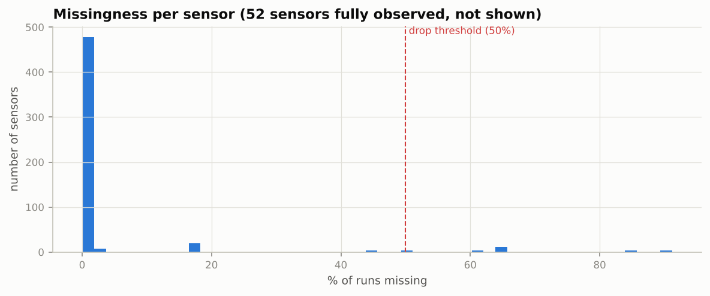
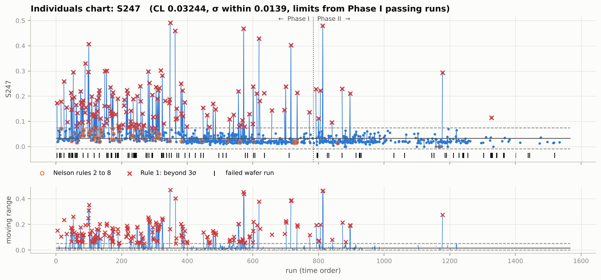
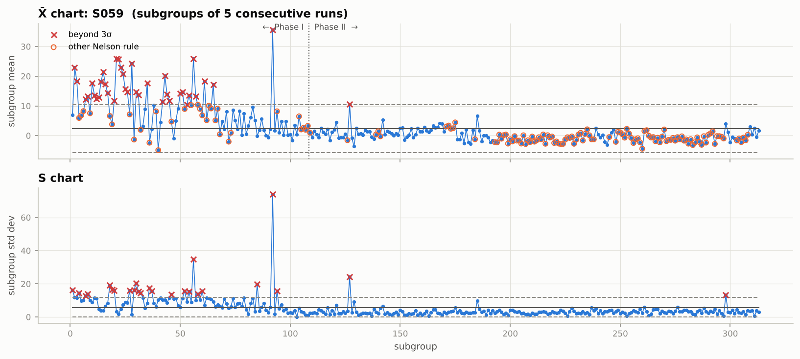
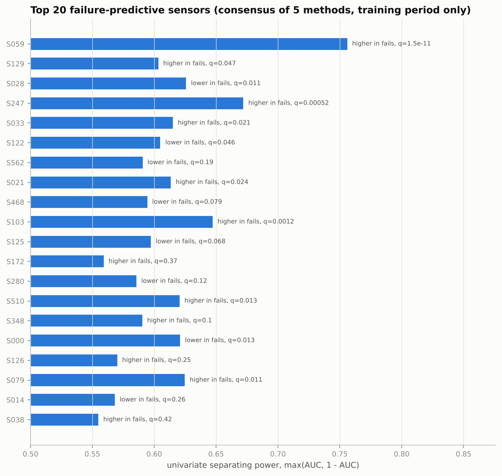
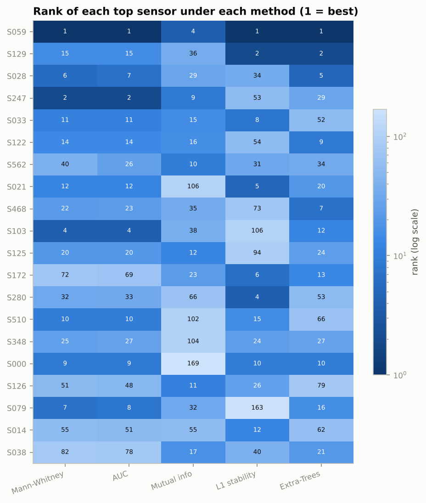
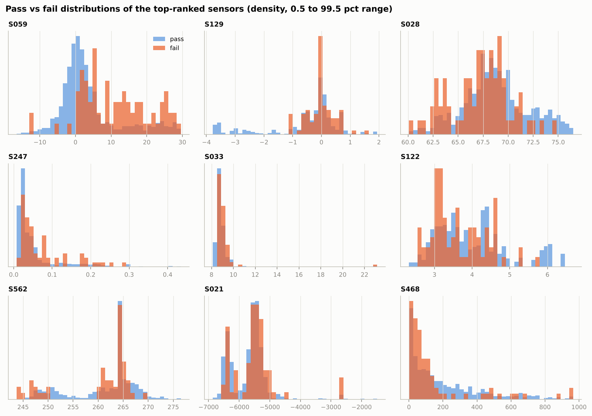

# SECOM: Statistical Process Control and Failure Analytics for a Semiconductor Fab

[](https://github.com/Shim-1122/secom-spc/actions/workflows/ci.yml)


An end-to-end SPC and yield analytics study on **real fab sensor data**: 1567 wafer production runs, 590 process sensors, and a pass/fail line-test result for each run (UCI SECOM dataset, July to October 2008).

The project builds what a process or yield engineer would build around a line like this:

* **Univariate SPC**: I-MR and X-bar/S control charts with Phase I / Phase II limits, all eight Nelson run rules, EWMA and CUSUM
* **Yield KPI monitoring**: daily yield, 7-day rolling yield, p chart and Laney p' chart of the fail rate
* **Process capability**: Cp, Cpk, Pp, Ppk and a non-normal (percentile) Cpk, tracked as capability drift
* **Multivariate SPC**: PCA-based Hotelling T² and SPE (Q) charts with contribution plots
* **Drift diagnostics**: KS tests, adversarial validation, and detection of sensors that were frozen and then came alive
* **Failure-driver ranking**: five statistical and ML views combined into a consensus, then stress-tested out of time and within week
* **Failure prediction**: leakage-safe pipelines evaluated on a temporal hold-out, walk-forward retraining, and shuffled CV for comparison
* **Dashboard exports**: tidy CSVs plus a build guide for a **Spotfire** dashboard and a **JMP JSL** script

Everything is reproducible with one command, covered by 34 unit tests, and every number below is read from `reports/summary.json` produced by the pipeline.

---

## Contents

1. [Key findings](#key-findings)
2. [The data](#the-data)
3. [Results in detail](#results-in-detail)
4. [Quick start](#quick-start)
5. [Repository layout](#repository-layout)
6. [Outputs](#outputs)
7. [Design decisions](#design-decisions)
8. [Limitations](#limitations)
9. [References and citation](#references-and-citation)

---

## Key findings

1. **The process changed between the first and second half of the data, and that dominates everything else.** A classifier can tell a Phase I run from a Phase II run with **AUC 0.999**. 168 of 324 sensors shift with KS p < 1e-6. Three sensors (S542, S543, S544) reported one frozen value for weeks and only started varying in early September, a pattern that usually means a stale tag or a sensor brought online, not a perfectly stable process.

2. **Per-sensor 3-sigma charts do not scale to 324 sensors.** Every single run trips at least one I-chart (median 23 sensors in alarm per run). Most sensors are heavy tailed: only 1.2 % pass a normality test. Multivariate SPC is the right tool, but it has to be built on clean baselines.

3. **Multivariate SPC finds the drift, and contribution analysis points straight at it.** With empirical limits, Hotelling T² alarms on 0.9 % of Phase II runs (nominal 1 %), but SPE alarms on **83.5 %**. Removing just the six frozen-then-live sensors cuts that to 31.7 %; removing the 20 most drifted sensors cuts it to 18.5 %. The SPE contribution plot for the worst failing Phase II run ranks S542 first.

4. **Yield improved from 91.5 % (Phase I) to 95.3 % (Phase II).** The p chart flags four early high-fail days, but day-to-day fail rates are over-dispersed (Laney sigma_z = 1.19), and after the Laney correction only one day remains out of control.

5. **Most "failure-predictive" sensors do not survive an honest test.** The top-ranked sensor in training, S059, has AUC 0.76 but **0.47 on the later hold-out**: its level and spread collapsed around run 480 as yield improved. Only a handful of sensors keep the same direction across all three checks (training AUC, within-week AUC, hold-out AUC), led by **S021, S247 and S033**, which are also over-represented in SPC alarms on failing runs (alarm lift 3.1x and 2.4x for S021 and S247, Fisher p < 0.01).

6. **Shuffled cross-validation badly overstates what is predictable.** Models reach ROC AUC 0.70 to 0.77 under the shuffled 10-fold CV used in most SECOM write-ups, but only **0.53 to 0.56 on the final 30 % of runs**, with confidence intervals that include 0.5. Walk-forward retraining recovers some signal (L1 logistic 0.50 to 0.61), which is the realistic deployment pattern for a drifting line.

The practical lesson matches how fabs actually operate: **re-baseline control limits after a known process change, quarantine sensors whose data quality changed, and retrain yield models on a schedule** rather than trusting a model fitted months earlier.

---

## The data

| | |
|---|---|
| Source | UCI Machine Learning Repository, SECOM (McCann & Johnston, 2008), CC BY 4.0 |
| Runs | 1567 production entities, one row each |
| Sensors | 590 anonymised signals (UCI lists 591 attributes including the label) |
| Labels | 104 fails (6.64 %), 1463 passes, from in-house line testing |
| Time span | 2008-07-19 11:55 to 2008-10-17 06:07, 86 production days, chronological |
| Missing | 4.54 % of sensor cells |
| Specs and units | none published |

Screening, fitted on Phase I only:

| Stage | Sensors |
|---|---|
| Input | 590 |
| Dropped: missing in > 50 % of runs | 24 |
| Dropped: constant or near-constant | 122 |
| Dropped: near-duplicate of a kept sensor (abs r > 0.98) | 120 |
| **Retained** | **324** |

<p align="center"></p>

---

## Results in detail

### Time splits

| Split | Runs | Fails | Used for |
|---|---|---|---|
| Phase I (first 50 %, to 2008-09-11) | 784 | 67 | control limits (717 passing runs), screening, imputation, PCA |
| Phase II | 783 | 37 | monitoring with frozen limits |
| Train (first 70 %) | 1097 | 78 | feature ranking, models, thresholds |
| Test (last 30 %, from 2008-09-26) | 470 | 26 | untouched hold-out |

### 1. Yield KPI

<p align="center"></p>

| KPI | Value |
|---|---|
| Overall yield | 93.4 % |
| Phase I yield | 91.5 % |
| Phase II yield | 95.3 % |
| Phase I p-bar (fail rate) | 8.6 % |
| Days above the p-chart UCL | 4 (Jul 25, Jul 29, Aug 10, Aug 17) |
| Laney sigma_z (over-dispersion) | 1.19 |
| Days above the Laney p' UCL | 1 |

The p-chart UCL is wide on low-volume days, which is why a 50 % fail day can still be in control. The Laney chart is the more defensible alarm when daily fail counts vary more than a binomial model allows.

### 2. Univariate control charts

Limits come from Phase I passing runs (with iterative removal of 3-sigma points) and are applied unchanged to Phase II. Orange circles mark Nelson rules 2 to 8, red crosses mark rule 1, black ticks mark failed runs.

<p align="center"></p>
<p align="center"></p>

S059 shows a clear regime change around run 480: high, noisy values early (where many early fails sit) and a tight band afterwards. That is exactly why it looks predictive in training and fails out of time.

X-bar / S on subgroups of five consecutive runs:

<p align="center"></p>

The alarm load problem:

<p align="center"></p>

| Univariate SPC metric | Value |
|---|---|
| Median per-sensor rule 1 rate, Phase I | 2.8 % (nominal 0.27 %) |
| Median per-sensor rule 1 rate, Phase II | 2.6 % |
| Sensors with > 5 % rule 1 rate in Phase II | 110 of 324 |
| Runs with at least one sensor beyond 3 sigma | 100 % |
| Mean sensors in alarm, passing vs failing runs | 23.7 vs 25.4 |

Moving-range sigma underestimates the spread of heavy-tailed sensors, so individual alarm rates run about ten times nominal, and across hundreds of sensors every run alarms somewhere.

### 3. Process capability (proxy specs)

There are no spec limits in SECOM, so each sensor gets proxy limits at its Phase I median +/- 4 robust sigma (a stable normal sensor would score about 1.33). The value is in the **change** from Phase I to Phase II.

<p align="center"></p>

| Capability metric | Value |
|---|---|
| Median Ppk, Phase I | 1.00 |
| Median Ppk, Phase II | 0.95 |
| Sensors with Ppk >= 1.33 in Phase II | 21.6 % |
| Sensors with Ppk < 1.0 in Phase II | 52.5 % |
| Sensors passing a normality test (5 %) | 1.2 % |
| Largest degradation | S542: Ppk 1.31 to -0.10, mean shift 5.7 SD, spread x5.7 |

### 4. Multivariate SPC

PCA on 324 standardised sensors needs **85 components** for 80 % of variance, which already says the sensors are only weakly correlated.

<p align="center"></p>

| Statistic | Parametric 99 % limit | Alarm rate, reference | Alarm rate, Phase II | Empirical 99 % limit | Alarm rate, Phase II |
|---|---|---|---|---|---|
| Hotelling T² | 137.8 | 8.5 % | 25.4 % | 271.4 | 0.9 % |
| SPE (Q) | 111.3 | 2.6 % | 94.6 % | 136.4 | 83.5 % |

The parametric T² limit assumes multivariate normality and alarms on 8.5 % of the very runs it was fitted on; the empirical limit fixes that. SPE explodes right at the Phase I / II boundary.

**Which sensors cause it?** The SPE contribution plot for failing run 1152:

<p align="center"></p>

**Sensitivity test**, refitting the monitor without the drifting sensors:

| Sensor set | Sensors | PCs | T² alarms, Phase II | SPE alarms, Phase II |
|---|---|---|---|---|
| All retained | 324 | 85 | 0.9 % | 83.5 % |
| Minus 6 frozen-then-live sensors | 318 | 84 | 0.6 % | 31.7 % |
| Minus top 20 KS-drift sensors | 304 | 82 | 0.9 % | 18.5 % |
| Minus all sensors with KS p < 1e-6 | 156 | 56 | 1.3 % | 7.9 % |

### 5. Drift

<p align="center"></p>

| Drift metric | Value |
|---|---|
| Adversarial validation AUC (Phase I vs II) | 0.999 |
| Sensors with KS p < 1e-6 | 168 |
| Largest KS statistics | S542 0.74, S078 0.74, S543 0.72, S544 0.61 |
| Frozen-then-live sensors | S114, S249, S521 (live from week of Aug 18); S542, S543, S544 (live from week of Sep 1) |

### 6. Which sensors predict failure?

Five views on the training period: Mann-Whitney U with Benjamini-Hochberg FDR, univariate AUC, mutual information, L1-logistic stability selection (200 bootstrap half-samples), and Extra-Trees importance. 17 sensors are significant at FDR 5 %, 24 at FDR 10 %.

<p align="center"></p>

The methods disagree a lot (pairwise Spearman correlation between rankings from 0.10 to 0.98), which is why a consensus is used:

<p align="center"></p>

**Robustness checks.** A sensor that merely trends with time looks predictive whenever the fail rate also trends. Within-week AUC compares fails only against passes from the same week:

<p align="center"></p>

| Sensor | Consensus rank | Train AUC | Within-week AUC | Hold-out AUC | FDR q | SPC alarm lift | Verdict |
|---|---|---|---|---|---|---|---|
| S059 | 1 | 0.756 | 0.645 | **0.473** | < 0.001 | 2.1x | real in the early regime, gone after the process change |
| S129 | 2 | 0.603 | 0.511 | 0.612 | 0.047 | 0.4x | mixed: fades within week, holds in hold-out |
| S028 | 3 | 0.374 | 0.476 | 0.428 | 0.011 | 0.5x | mixed: weak within week, direction holds |
| **S247** | 4 | 0.672 | 0.564 | 0.562 | < 0.001 | **2.4x** (p < 0.001) | holds on all checks |
| **S033** | 5 | 0.615 | 0.564 | 0.584 | 0.021 | 1.6x | holds on all checks |
| S122 | 6 | 0.395 | 0.462 | 0.443 | 0.046 | 1.2x | mixed: weak within week, direction holds |
| **S021** | 8 | 0.613 | 0.619 | 0.580 | 0.024 | **3.1x** (p = 0.009) | strongest overall evidence |
| S103 | 10 | 0.647 | 0.494 | 0.715 | 0.001 | 1.5x | mixed: no within-week signal, strong in hold-out |

(AUC below 0.5 means the sensor is lower in failing runs.) Pass vs fail distributions for the top nine:

<p align="center"></p>

### 7. Predicting failure

Threshold chosen on out-of-fold training predictions (minimum balanced error rate), then frozen. Test set: 470 runs, 26 fails, base rate 5.5 %.

| Model | Train CV AUC | Test ROC AUC [95 % CI] | Test PR AUC | Test BER | Fails caught | Specificity |
|---|---|---|---|---|---|---|
| L1 logistic, all sensors | 0.744 | 0.532 [0.42, 0.64] | 0.068 | 0.494 | 23 % | 78 % |
| Logistic, top 20 by AUC (in-fold) | 0.661 | 0.563 [0.44, 0.68] | 0.097 | 0.423 | 35 % | 81 % |
| Random forest | 0.773 | 0.536 [0.42, 0.65] | 0.064 | 0.503 | 4 % | 96 % |
| Gradient boosting | 0.763 | 0.545 [0.44, 0.65] | 0.060 | 0.516 | 12 % | 85 % |
| *SPC: # sensors beyond 3 sigma* | 0.562 | 0.650 [0.55, 0.75] | 0.083 | 0.399 | 88 % | 32 % |
| *MSPC: Hotelling T²* | 0.458 | 0.454 [0.32, 0.59] | 0.062 | 0.541 | 62 % | 30 % |
| *MSPC: SPE* | 0.674 | 0.481 [0.36, 0.60] | 0.057 | 0.500 | 100 % | 0 % |

<p align="center"></p>

Comparison with **shuffled** stratified 10-fold CV on all data (the setup most SECOM results use):

| Model | Shuffled CV ROC AUC | Shuffled CV PR AUC | Temporal hold-out ROC AUC |
|---|---|---|---|
| L1 logistic | 0.732 | 0.169 | 0.532 |
| Logistic, top 20 | 0.701 | 0.143 | 0.563 |
| Random forest | 0.768 | 0.180 | 0.536 |
| Gradient boosting | 0.734 | 0.192 | 0.545 |

For reference, the donors' baseline reported balanced error rates of about 34 % at best with 10-fold CV. The shuffled numbers here (BER about 0.29 to 0.32, threshold tuned on the same predictions, so optimistic) are in that range; the temporal numbers are not.

**Walk-forward retraining** (score each block of 100 Phase II runs with a model trained on everything before it; 783 runs, 37 fails):

<p align="center"></p>

| Model | Trained once | Retrained every block | Retrained, sliding 500-run window |
|---|---|---|---|
| Logistic, top 20 | 0.453 | 0.556 [0.45, 0.66] | 0.519 |
| L1 logistic, all sensors | 0.500 | **0.611 [0.52, 0.70]** | |
| Gradient boosting | 0.642 [0.56, 0.73] | 0.602 | |

With 26 to 37 failures in each evaluation, intervals are wide. The defensible conclusion is that the label signal in these sensors is weak and non-stationary, and that retraining matters more than model choice for the linear models.

---

## Quick start

```bash
git clone https://github.com/Shim-1122/secom-spc.git
cd secom-spc
python -m pip install -e ".[dev]"

python -m secom_spc.pipeline           # full run, about 8 minutes on a laptop
python -m secom_spc.pipeline --fast    # about 2 minutes: fewer bootstraps, skips shuffled CV, 1 walk-forward model
pytest -q                              # 34 unit tests
```

The raw data is included in `data/raw/`. To re-download it from UCI: `python scripts/download_data.py --force`. A `Makefile` wraps the same commands (`make run`, `make fast`, `make test`).

All tunable settings (phase split, subgroup size, EWMA and CUSUM parameters, proxy spec width, PCA variance target, model hyperparameters) live in [`src/secom_spc/config.py`](src/secom_spc/config.py).

Use the modules directly:

```python
from secom_spc.data import load, phase_split
from secom_spc import spc

d = load()
p1, _ = phase_split(len(d), 0.5)
ref = p1 & (d.y.values == 0)
chart = spc.imr_chart(d.X["S247"].values, ref)
chart[chart.phase == "II"].any_rule.mean()   # Phase II run-rule violation rate
```

---

## Repository layout

```text
secom-spc/
├── src/secom_spc/
│   ├── config.py          all parameters in one dataclass
│   ├── data.py            load and time-order the raw files, phase splits
│   ├── preprocess.py      Phase I sensor screening, imputation, robust scale
│   ├── spc.py             I-MR, X-bar/S, p, Laney p', EWMA, CUSUM, exact constants
│   ├── rules.py           Nelson rules 1 to 8 (vectorised)
│   ├── capability.py      Cp, Cpk, Pp, Ppk, percentile Cpk, bootstrap CI
│   ├── multivariate.py    PCA Hotelling T² and SPE, limits, contributions
│   ├── drift.py           KS drift, adversarial validation, frozen sensors, within-week AUC
│   ├── features.py        five ranking methods, FDR, alarm lift, consensus
│   ├── modeling.py        leakage-safe pipelines, temporal, walk-forward and shuffled CV
│   ├── plots.py           report figures
│   └── pipeline.py        end-to-end CLI
├── tests/                 34 unit tests (constants, rules, capability, MSPC, leakage, confounding)
├── data/raw/              SECOM files (CC BY 4.0)
├── reports/
│   ├── figures/           every chart in this README
│   ├── tables/            every intermediate table as CSV
│   ├── exports/           dashboard-ready CSVs for Spotfire / JMP / Excel
│   └── summary.json       every headline number, machine readable
├── docs/
│   ├── methodology.md     formulas and rationale for every step
│   └── spotfire_dashboard.md  page-by-page Spotfire build spec
├── jmp/secom_spc.jsl      JMP script rebuilding the control charts from the exports
├── scripts/download_data.py
└── .github/workflows/ci.yml  lint, tests, smoke run on Python 3.10 and 3.12
```

---

## Outputs

### Dashboard exports (`reports/exports/`)

| File | Grain | Highlights |
|---|---|---|
| `runs.csv` | 1 row per run | result, phase, # sensors in alarm, T², SPE, both limit types, alarm flags, predicted fail probability, PC1/PC2 |
| `daily_kpi.csv` | 1 row per day | runs, fails, yield, 7-day yield, p and Laney limits, OOC flags |
| `weekly_kpi.csv` | 1 row per week | runs, fails, yield |
| `spc_top_sensors_long.csv` | run x top-20 sensor | value, CL/LCL/UCL, z, moving range, EWMA, CUSUM, all 8 Nelson flags |
| `sensor_ranking.csv` | 1 row per sensor | all ranking metrics, within-week and hold-out AUC, alarm lift |
| `capability.csv` | 1 row per sensor | proxy specs, Cpk/Ppk in each phase, shift, spread ratio, normality |

* **Spotfire**: [`docs/spotfire_dashboard.md`](docs/spotfire_dashboard.md) specifies data tables, relations, calculated columns, five dashboard pages and alert rules.
* **JMP**: [`jmp/secom_spc.jsl`](jmp/secom_spc.jsl) opens the exports and builds Control Chart Builder I-MR charts with Phase and Nelson tests, the p chart, the yield trend and T²/SPE plots. It is written for JMP 17/18 and has not been executed in CI.

### Analysis tables (`reports/tables/`)

Screening log, duplicate-sensor map, missingness, per-sensor SPC summary, capability, KS drift, adversarial importances, frozen sensors, MSPC sensitivity, sensor ranking and method agreement, X-bar/S tables, temporal / walk-forward / shuffled model comparisons, daily and weekly yield.

---

## Design decisions

| Decision | Why |
|---|---|
| Every fit uses only earlier data | fab data drifts; anything else leaks the future |
| Limits from Phase I **passing** runs, with iterative 3-sigma cleanup | a "known good" reference, as in a real control plan |
| Moving-range sigma for I charts | short-term noise, insensitive to slow drift |
| Charts use raw values, models use imputed values | a missing reading should never fire an alarm |
| Laney p' alongside p chart | daily fail counts are over-dispersed |
| Proxy specs, reported as capability **drift** | SECOM publishes no specs, so absolute Cpk would be fiction |
| Empirical MSPC limits alongside F / chi-square | sensors are heavy tailed, parametric limits over-alarm |
| Five ranking methods plus within-week and hold-out checks | single methods disagree; time trends masquerade as signal |
| Selection inside CV folds | top-k filtering outside the fold inflates CV scores |
| BER, PR AUC and bootstrap CIs | 6.6 % fail rate makes accuracy meaningless |

Full formulas and references: [`docs/methodology.md`](docs/methodology.md).

---

## Limitations

* Sensors are anonymised, so no physical root cause can be named, and Cpk uses proxy specs.
* Only 104 failures; hold-out and walk-forward periods contain 26 and 37. Small AUC differences are noise.
* The pass/fail label comes from a downstream test that may depend on steps not captured here.
* Runs are treated as independent; autocorrelation would make some univariate alarm rates higher than nominal.
* The Spotfire dashboard is specified, not shipped as a `.dxp`; the JSL script has not been run inside JMP in CI.

---

## References and citation

* Montgomery, D. C. *Introduction to Statistical Quality Control*, 8th ed., Wiley, 2019.
* Nelson, L. S. (1984). The Shewhart control chart: tests for special causes. *J. Quality Technology* 16(4).
* Laney, D. B. (2002). Improved control charts for attributes. *Quality Engineering* 14(4).
* Jackson, J. E. & Mudholkar, G. S. (1979). Control procedures for residuals associated with PCA. *Technometrics* 21(3).
* MacGregor, J. F. & Kourti, T. (1995). Statistical process control of multivariate processes. *Control Engineering Practice* 3(3).
* Meinshausen, N. & Buehlmann, P. (2010). Stability selection. *JRSS B* 72(4).

Dataset: McCann, M. & Johnston, A. (2008). *SECOM* [Dataset]. UCI Machine Learning Repository. https://doi.org/10.24432/C54305 (CC BY 4.0)

Code: MIT License, (c) 2026 Shyam Iyer.
