# Statistical Process Control and Failure Analysis of the UCI SECOM Semiconductor Dataset

[](https://github.com/Shim-1122/secom-spc/actions/workflows/ci.yml)

Shyam Iyer, Rutgers University

**Key finding:** a sensor instrumentation change on 7 September 2008 (run 737) made frozen control limits raise about 15 false alarms per day; re-baselining after the change cut that to under 1 per day.


A 50-second walkthrough of the result ([full-quality MP4](docs/walkthrough.mp4)). **[Open the live interactive dashboard](https://shim-1122.github.io/secom-spc/)** (Section 5.3).

Tools: [Spotfire dashboard](spotfire/SECOM_SPC_Dashboard.dxp) | [JMP script](jmp/secom_spc.jsl) | [Excel workbook with VBA macros](excel/SECOM_SPC.xlsm) ([module](excel/SECOM_SPC.bas)) | [Python package](src/secom_spc)

## Engineering summary

| | |
|---|---|
| **Excursion** | A sustained process change on **7 September 2008**, detected from the sensor data alone (no pass/fail labels used). |
| **Probable cause** | Instrumentation, not the process recipe. Seven sensors reported a single held value for weeks and began reporting live values in late August and early September (S114, S249, S521, S542, S543, S544, S545). They account for almost all of the multivariate alarms that follow. |
| **Effect on monitoring** | With limits frozen from before the change, the multivariate monitor raises about **15 alarms per production day**, nearly all on passing runs. Re-baselining on the first 250 passing runs after the change brings this to **0.3 per day**. Removing the seven sensors alone cuts the SPE alarm rate from 70 % to 2 %. |
| **Effect on the line** | The line-test pass rate rose from 90.9 % to 95.5 % across the change. The monitor alarms do not track failures: under no limit strategy are failed runs flagged more often than passing runs, and alarm days are no more common on high-fail days than on others. |
| **Recommended action** | Re-baseline the multivariate limits after the instrumentation change, and quarantine sensors whose data quality changed before using them in any control plan. |
| **Follow-up candidates** | S021, S247 and S033 are the only top-ranked sensors whose association with failure holds within a week and on later data. Effects are modest (AUC about 0.56 to 0.62). |
| **Not possible with this data** | Commonality analysis: SECOM has no lot, wafer, tool or chamber identifiers. Capability: no specification limits are published. |

## Abstract

SECOM records 590 in-line sensor and metrology signals for 1567 production runs of a semiconductor fab between July and October 2008, each with a pass/fail result from a downstream line test. This repository applies univariate and multivariate statistical process control (SPC) to the data and asks which sensors are associated with failure. The control plan is baselined on the period before a process change that is estimated from the sensors themselves, and every limit and model is evaluated on later data than it was fitted on.

The change on 7 September is large: a classifier separates runs before and after it with AUC 1.00. It is driven mostly by seven sensors that switched from a held value to live readings. A PCA-based monitor with limits frozen from before the change alarms on 70 % of later runs. Excluding those seven sensors reduces the SPE alarm rate to 2.3 %, and re-baselining after the change reduces the overall alarm rate to 1.4 %. Neither the monitor nor any classifier predicts line-test failures usefully after the change. Classifiers that reach ROC AUC 0.70 to 0.76 under the shuffled cross-validation used in most published SECOM results reach 0.52 to 0.58 on a temporal hold-out, and most sensor associations found in the training period disappear when comparisons are restricted to runs from the same week.

## Contents

1. [Introduction](#1-introduction)
2. [Data](#2-data)
3. [Methods](#3-methods)
4. [Results](#4-results)
5. [Discussion](#5-discussion)
6. [Limitations](#6-limitations)
7. [Reproducing the analysis](#7-reproducing-the-analysis)
8. [References](#references)

## 1. Introduction

A semiconductor line produces far more process measurements than an engineer can inspect, while only a small fraction of runs fail. Two questions follow. The monitoring question asks which runs and sensors depart from a known-good reference, how many alarms that generates, and when the reference should be reset. The diagnostic question asks which sensors carry information about failure. SECOM, donated to the UCI Machine Learning Repository by McCann and Johnston (2008), is one of the few public datasets in which both questions can be studied on production data.

Most published work on SECOM treats it as a static classification benchmark and evaluates with shuffled cross-validation. The runs are time-stamped, however, and fab processes are not stationary. This project treats time as the primary axis. In practice a fab re-baselines its control limits after a known event such as preventive maintenance, a recipe change or an instrumentation change. SECOM records no events, so the boundary between the reference period (Phase I) and the monitoring period (Phase II) is estimated from the sensors.

## 2. Data

All figures below were obtained by loading the raw files.

| Property | Value |
|---|---|
| Runs | 1567 production entities, one row each |
| Sensors | 590 anonymised signals. UCI lists 591 attributes; the extra one is the label. |
| Outcome | 104 fails (6.64 %) and 1463 passes in a downstream line test |
| Period | 2008-07-19 11:55 to 2008-10-17 06:07, 86 production days, stored in time order |
| Missing values | 4.54 % of sensor cells |
| Not provided | sensor names and units, specification limits, lot, wafer, tool and chamber identifiers |

The outcome is reported as the **line-test pass rate**, the share of runs that pass the line test. It is not die-level yield.

Sensors were screened on Phase I data. Twenty-four were missing in more than half of the runs, 122 were constant or nearly constant, and 123 duplicated an earlier sensor (absolute Pearson correlation above 0.98). The remaining 321 sensors are used throughout.

Table 1. Time-based partitions.

| Partition | Runs | Fails | Role |
|---|---|---|---|
| Phase I (to 2008-09-05) | 736 | 67 | Reference: control limits (from its 669 passing runs), screening, imputation |
| Phase II (from 2008-09-07) | 831 | 37 | Monitoring |
| Re-baselining window (Phase II, to 2008-09-21) | first 250 passing runs | | Refitting limits after the change |
| Monitoring period (after the window) | 572 | 28 | Comparison of limit strategies (27 production days) |
| Model training (first 70 %) | 1097 | 78 | Sensor ranking, model fitting, threshold selection |
| Model test (last 30 %, from 2008-09-26) | 470 | 26 | Hold-out evaluation |

## 3. Methods

Formulas, constants and references for each step are in [docs/methodology.md](docs/methodology.md).

**Change-point estimation.** Each sensor is rank-transformed and standardised. For each candidate boundary at the start of a production day, the squared difference in sensor means before and after the boundary is summed over sensors and weighted as in the CUSUM change-point statistic. The boundary that maximises this statistic is the estimate. The same search inside each segment gives secondary change points. Pass/fail labels are not used.

**Univariate SPC.** Each sensor receives an individuals and moving-range (I-MR) chart. Limits come from the Phase I passing runs after up to three rounds of removing points beyond 3 sigma, and all eight Nelson run rules are evaluated. X-bar/S, EWMA and CUSUM charts are produced for the top-ranked sensors.

**Pass-rate monitoring.** The daily fail fraction is plotted on a p chart with variable limits and on a Laney p' chart, which corrects the limits for over-dispersion.

**Shift and spread.** For each sensor, the median shift between phases is expressed in Phase I robust standard deviations (1.4826 times the MAD), and the spread ratio is the Phase II robust standard deviation divided by the Phase I value. A two-sample Kolmogorov-Smirnov test compares the full distributions. These measures need no specification limits.

**Multivariate SPC.** Sensors are standardised with reference statistics and projected onto the principal components that explain 80 % of reference variance. Hotelling's T² measures variation within that subspace and the squared prediction error (SPE, or Q) measures variation outside it. Reference runs are scored out-of-fold, so that the limits are not set on runs the model was fitted to. Alarms use empirical limits equal to the 99th percentile of the reference statistics; parametric limits are reported for comparison. SPE contributions identify the sensors behind an alarm.

**Drift diagnostics.** Adversarial validation trains a random forest to tell Phase I runs from Phase II runs. A sensor is flagged as frozen, then live, if it reports a single value for at least two complete weeks and later varies. The monitor is refitted without the drifting sensors to measure their share of the alarms.

**Monitor operating characteristics.** Three limit strategies are compared on the monitoring period: limits frozen from Phase I; limits re-baselined on the first 250 passing runs after the change; and rolling limits refitted each morning on the last 150 passing runs. For each, the report gives alarms and false alarms per production day, the share of failed runs flagged, and whether high-fail days (at least three failures and a fail rate at least twice the Phase I rate) attract more alarms than other days.

**Ranking failure-related sensors.** Five criteria are computed on the training partition: the Mann-Whitney U test with Benjamini-Hochberg correction, univariate ROC AUC, mutual information, L1-logistic stability selection and Extra-Trees importance. The consensus rank orders sensors by their mean rank. Two checks test each association: AUC on the later test partition, and a within-week AUC that compares failing runs only with passing runs from the same week. Alarm lift is the fail rate among runs in which a sensor's I chart signalled, divided by the overall fail rate.

**Failure prediction.** An L1-penalised logistic regression, a logistic regression on the 20 sensors with the highest AUC (selected within each fold), a random forest and histogram gradient boosting are compared with three model-free scores (sensors beyond 3 sigma, T², SPE). Preprocessing is refitted within every fold, and the decision threshold minimises the balanced error rate (BER) on out-of-fold training predictions. Performance is reported on the temporal hold-out, in walk-forward evaluation from the change point, and under shuffled 10-fold cross-validation for comparison with the literature.

## 4. Results

### 4.1 A process change on 7 September

The change-point statistic peaks for a boundary at the start of 7 September (run 737), with a broad plateau from 4 to 9 September (Figure 1). Removing the frozen-then-live sensors does not move the estimate. Secondary change points fall on 27 August (run 451) and 28 September (run 1142). Runs before and after 7 September can be told apart with a cross-validated adversarial AUC of 1.00.

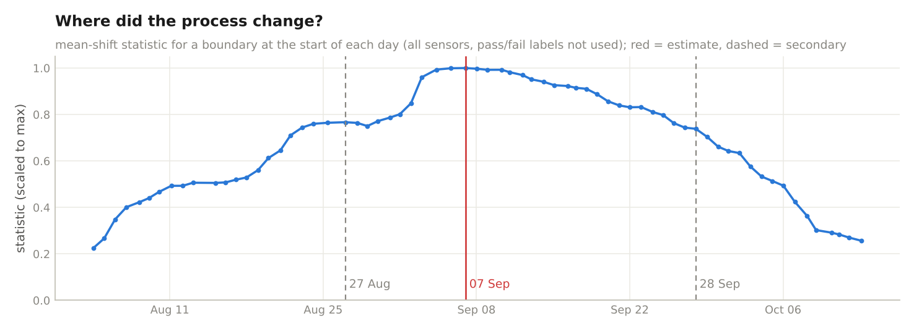
*Figure 1. Change-point statistic for a boundary at the start of each production day, scaled to its maximum.*

The line-test pass rate rises from 90.9 % before the change to 95.5 % after it (Figure 2). Against the Phase I fail fraction of 9.1 %, the p chart flags two days: 25 July, which had a single run, and 10 August (5 failures in 12 runs). Daily fail counts are over-dispersed (Laney sigma_z = 1.24), and the Laney p' chart flags only 10 August.

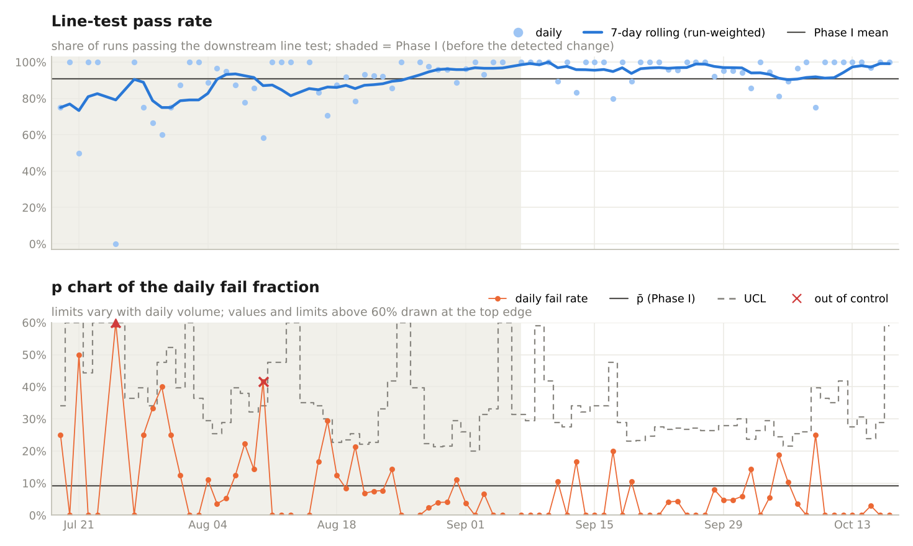
*Figure 2. Daily and seven-day rolling line-test pass rate (top), and p chart of the daily fail fraction (bottom).*

### 4.2 Which sensors moved

Of the 321 sensors, 169 differ between phases at KS p < 1e-6, 72 change spread by more than a factor of 1.5, and 20 shift their median by more than one Phase I robust standard deviation (Figure 3). A handful dominate. S542 shifts by 9.0 robust SDs with an 8.7-fold increase in spread; S543, S544 and S545 shift by 7 to 11 SDs with 16- to 20-fold increases in spread.

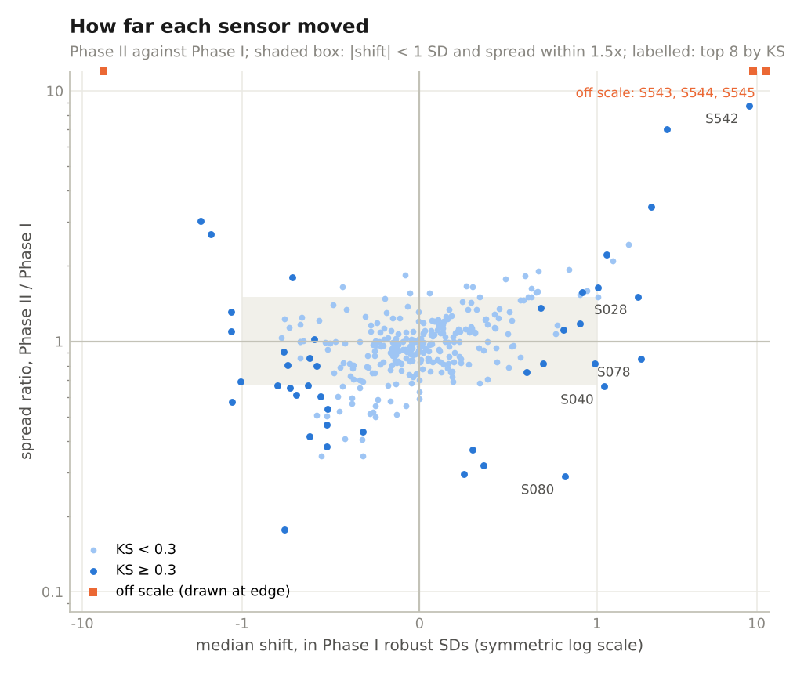
*Figure 3. Median shift against spread ratio between phases, one point per sensor.*

These are the sensors that had been frozen. S542 to S545 reported a single value from the start of the record and began to vary in the week of 1 September; S114, S249 and S521 did the same from the week of 18 August (Figure 4). A long run of identical readings usually indicates a held or stale value. Limits fitted to that stretch cannot describe the sensor once it reports live data.

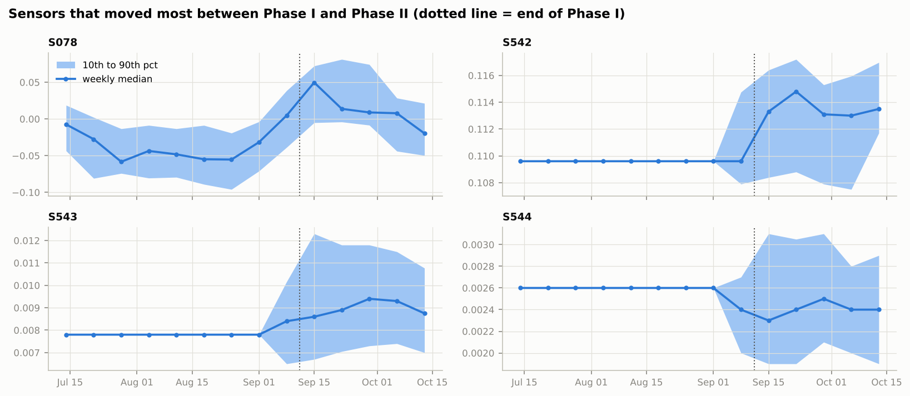
*Figure 4. Weekly median and 10th to 90th percentile band for the sensors with the largest change between phases.*

### 4.3 Multivariate monitoring with limits from Phase I

Eighty-four principal components are needed to explain 80 % of reference variance, so the sensors are only weakly correlated. Scored out-of-fold, 5.1 % of reference runs exceed the parametric T² limit, against a nominal 1 %, because the sensors are far from normal. The empirical limits are therefore used. With them, T² signals on 2.0 % of Phase II runs and SPE on 68.5 % (Figure 5).

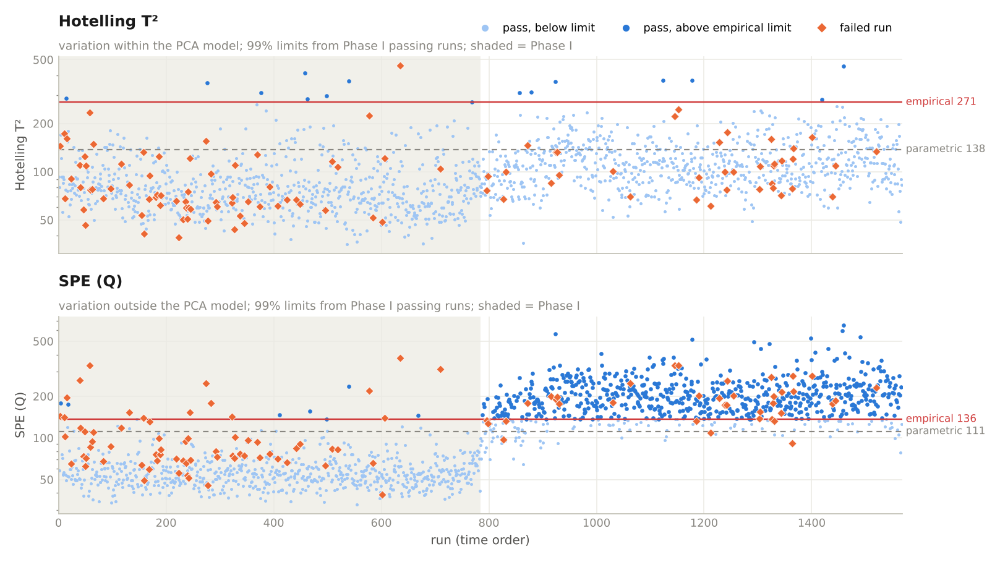
*Figure 5. Hotelling T² and SPE for every run, log scale. The solid red line is the empirical 99 % limit; the dashed line is the parametric limit.*

For the failing Phase II run with the largest SPE (run 1145), four of the frozen-then-live sensors supply 62 % of the statistic (Figure 6). Table 2 confirms the pattern for the monitoring period as a whole.

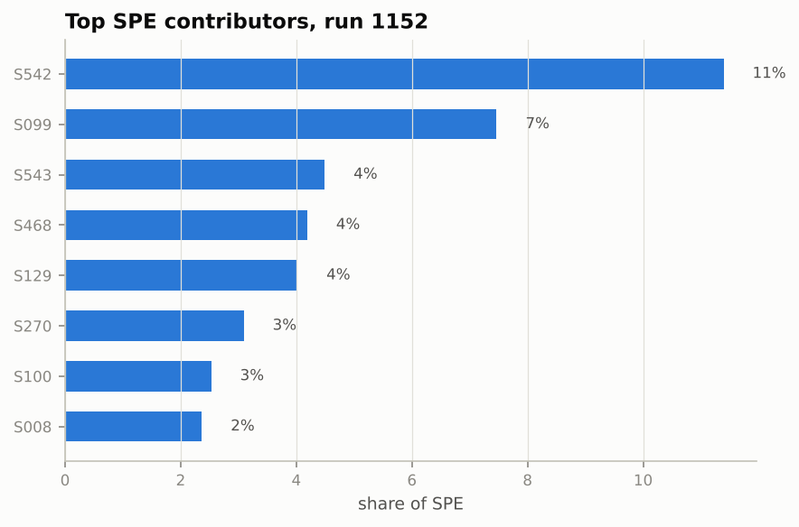

*Figure 6. Share of SPE contributed by the top eight sensors for run 1145.*

The same holds across all runs. Summing SPE contributions over each phase, the seven frozen-then-live sensors carry 2.6 % of total SPE before the change and 58.3 % after it, and four of them (S543, S545, S542, S544) account for almost all of that (Figure 6b). No other sensor exceeds 1.2 %.

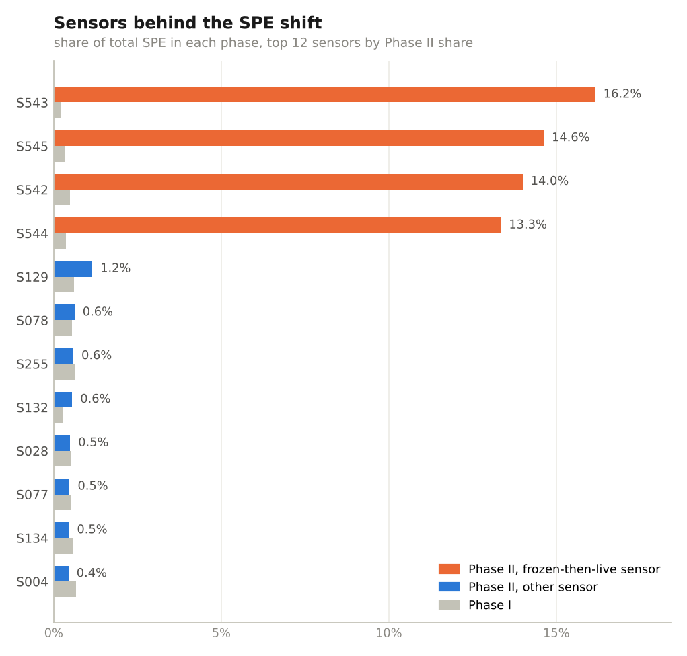

*Figure 6b. Share of total SPE by sensor in each phase, for the twelve sensors with the largest Phase II share. Phase I shares come from the model fitted on those runs.*

Table 2. Alarm rates in the monitoring period under different sensor sets and baselines (empirical 99 % limits).

| Limits fitted on | Sensors | Number | PCs | T² alarms | SPE alarms |
|---|---|---|---|---|---|
| Phase I | all retained | 321 | 84 | 3.8 % | 69.6 % |
| Phase I | excluding the 7 frozen-then-live sensors | 314 | 83 | 2.1 % | 2.3 % |
| Phase I | excluding the 20 sensors with largest KS | 301 | 81 | 1.0 % | 2.3 % |
| Phase I | excluding all sensors with KS p < 1e-6 | 152 | 55 | 1.0 % | 1.9 % |
| Re-baselining window | all retained | 321 | 66 | 0.7 % | 1.2 % |

### 4.4 Alarm burden and what the monitor catches

Table 3 shows the practical consequence. Frozen limits would have given an engineer about 15 alarms to triage every production day after the change, nearly all on passing runs. Re-baselining reduces this to 0.3 per day, and rolling limits to 0.8 per day without needing to know when the change happened (Figure 7).

Table 3. Operating characteristics over the monitoring period (572 runs, 28 failures, 27 production days).

| Limits | Runs in alarm | Alarms per day | False alarms per day | Failed runs flagged | Fail rate, alarmed | Fail rate, not alarmed |
|---|---|---|---|---|---|---|
| Frozen from Phase I | 69.8 % | 14.8 | 14.1 | 60.7 % | 4.3 % | 6.4 % |
| Re-baselined after the change | 1.4 % | 0.30 | 0.30 | 0 % | 0 % | 5.0 % |
| Rolling, last 150 passing runs | 4.0 % | 0.85 | 0.81 | 3.6 % | 4.3 % | 4.9 % |

None of the strategies is informative about line-test failure. The frozen monitor flags 61 % of failed runs only because it flags 70 % of all runs, and the fail rate among its alarms is lower than among the runs it leaves alone. The rolling monitor can also be evaluated in Phase I from 10 August, once its first window is full. There it flags 3.2 % of runs and 4.7 % of failed runs (fail rate 11.1 % among alarms against 7.6 % otherwise, from 18 alarms). Of the four high-fail days it covers, two had at least one alarm (20 August and 5 October) and two had none (10 and 17 August). That is close to the rate on other days (45 %), and the daily alarm rate is not correlated with the daily fail rate (Spearman rho = -0.18, p = 0.14).

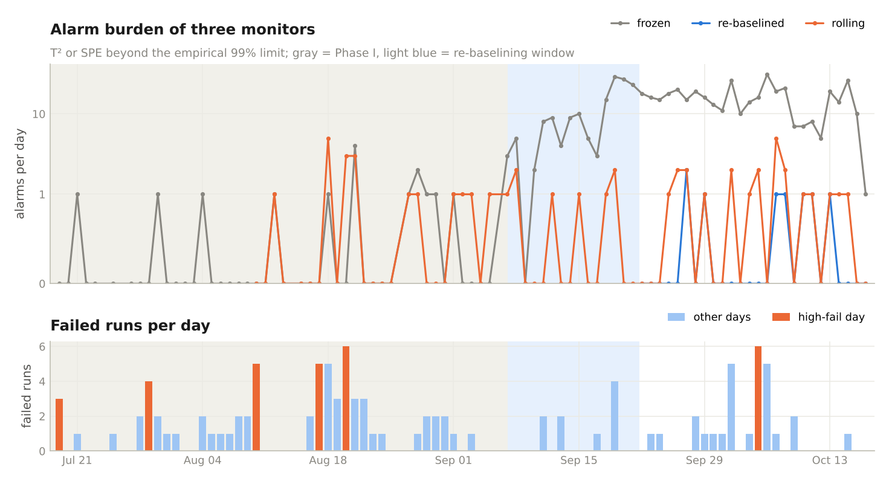
*Figure 7. Alarms per production day under each limit strategy (top, symmetric log scale) and failed runs per day (bottom). Each monitor is drawn only where it is a genuine forward-looking monitor.*

### 4.5 Per-sensor control charts

Charting each sensor separately does not work at this scale. With Phase I limits, the median sensor exceeds 3 sigma on 2.9 % of Phase I runs and 2.5 % of Phase II runs, about ten times the nominal 0.27 %, because only 1.2 % of sensors pass a normality test and the moving-range estimator understates the spread of heavy-tailed data. Every run has at least one sensor beyond 3 sigma (median 23). Individual charts remain useful for inspecting one sensor. Figure 8 shows S059, which changes regime around run 450, at the 27 August secondary change point. The other charts are in [reports/figures](reports/figures).

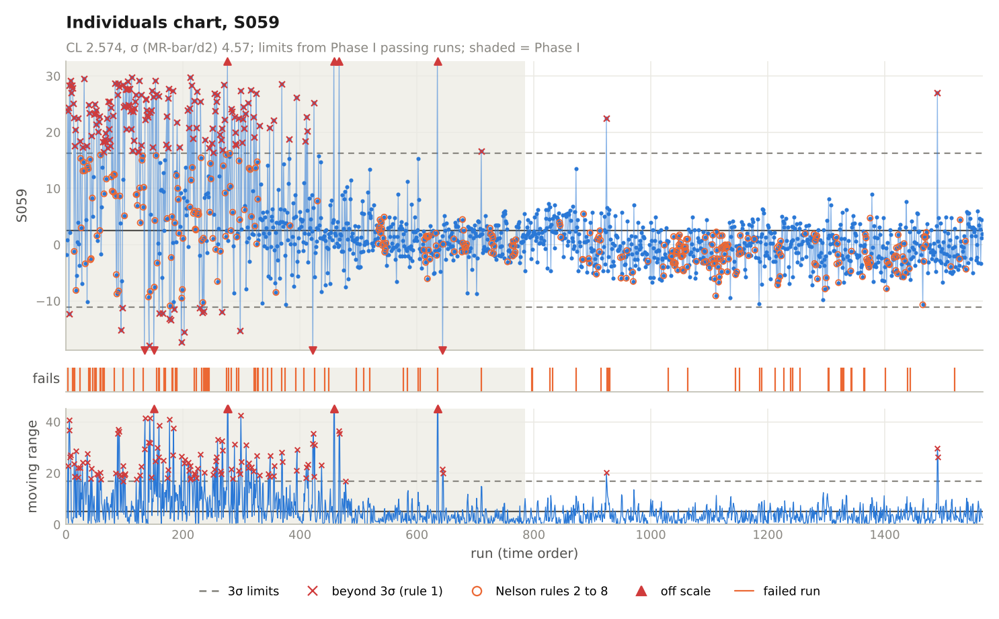
*Figure 8. I-MR chart for S059. Crosses mark points beyond 3 sigma, open circles other Nelson rule violations, triangles values beyond the plotted range; the strip between the panels marks failed runs.*

### 4.6 Sensors associated with failure

On the training partition, 17 sensors differ between failing and passing runs at a false discovery rate of 5 % (24 at 10 %). The five ranking criteria agree poorly, with pairwise Spearman correlations from 0.09 to 0.98. Table 4 lists the highest-ranked sensors with the two out-of-sample checks. An AUC below 0.5 means the sensor reads lower in failing runs.

Table 4. Top-ranked sensors and robustness checks.

| Sensor | Rank | Training AUC | Within-week AUC | Test AUC | FDR q | Alarm lift (Fisher p) | Assessment |
|---|---|---|---|---|---|---|---|
| S059 | 1 | 0.756 | 0.645 | 0.473 | < 0.001 | 1.9 (0.006) | Association confined to the early regime |
| S129 | 2 | 0.603 | 0.511 | 0.612 | 0.047 | 0.4 (1.0) | No within-week association |
| S247 | 3 | 0.672 | 0.564 | 0.562 | < 0.001 | 2.2 (< 0.001) | Consistent on all checks |
| S028 | 4 | 0.374 | 0.476 | 0.428 | 0.011 | 0.5 (0.98) | Weak within week |
| S122 | 5 | 0.395 | 0.462 | 0.443 | 0.046 | 1.2 (0.049) | Weak within week |
| S033 | 6 | 0.615 | 0.564 | 0.584 | 0.020 | 1.6 (0.25) | Consistent on all checks |
| S021 | 10 | 0.613 | 0.619 | 0.580 | 0.024 | 3.1 (0.009) | Consistent on all checks |
| S103 | 11 | 0.647 | 0.494 | 0.715 | 0.001 | 1.4 (0.20) | No within-week association in training |

S059 separates the classes well in training (AUC 0.76) but not on the test partition (0.47), because the regime in which it did so ended in late August (Figure 8). Among the top 40, only S247, S033 and S021 keep the same direction on every check with an effect of at least 0.05, together with four weaker sensors (S126, S130, S133, S040). S021 and S247 are also over-represented in I-chart alarms on failing runs. Figure 9 compares pooled and within-week AUC.

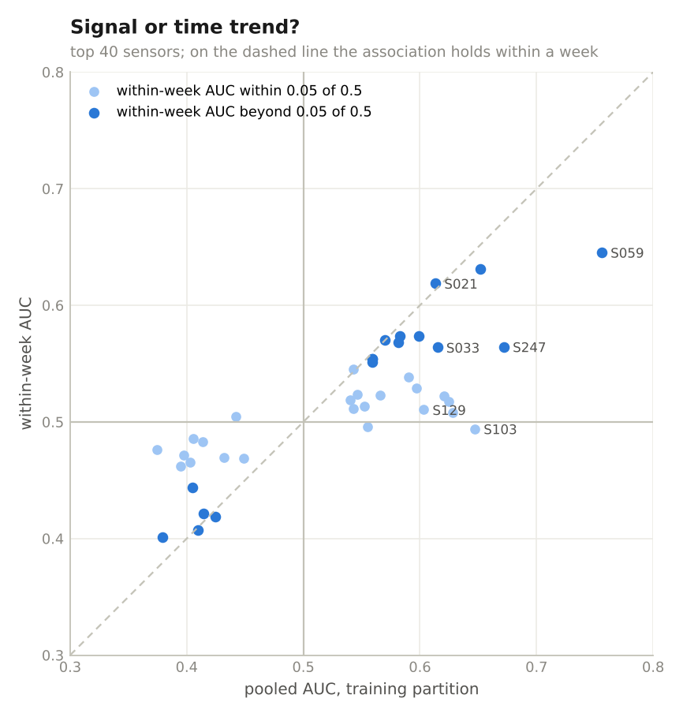
*Figure 9. Training AUC against within-week AUC for the top 40 sensors. Sensors near the dashed line keep their association within a week; sensors near 0.5 on the vertical axis owe their pooled AUC to a time trend.*

### 4.7 Failure prediction

Table 5 reports the temporal hold-out: 470 runs, 26 failures, a base rate of 5.5 %.

Table 5. Temporal hold-out performance, with cross-validated AUC on the training partition for reference.

| Model | Training CV AUC | Test AUC (95 % CI) | Test PR AUC | Test BER | Recall | Specificity |
|---|---|---|---|---|---|---|
| L1 logistic, all sensors | 0.744 | 0.534 (0.42 to 0.64) | 0.070 | 0.471 | 0.27 | 0.79 |
| Logistic, top 20 sensors | 0.661 | 0.563 (0.44 to 0.68) | 0.097 | 0.423 | 0.35 | 0.81 |
| Random forest | 0.769 | 0.576 (0.46 to 0.68) | 0.078 | 0.496 | 0.08 | 0.93 |
| Gradient boosting | 0.752 | 0.518 (0.42 to 0.62) | 0.057 | 0.513 | 0.15 | 0.82 |
| Baseline: sensors beyond 3 sigma | 0.559 | 0.636 (0.53 to 0.74) | 0.081 | 0.369 | 0.85 | 0.42 |
| Baseline: Hotelling T² | 0.512 | 0.495 (0.36 to 0.63) | 0.063 | 0.541 | 0.50 | 0.42 |
| Baseline: SPE | 0.420 | 0.461 (0.35 to 0.57) | 0.053 | 0.500 | 1.00 | 0.00 |

Every classifier loses most of its discrimination between training and test, and every classifier's test interval includes 0.5. The count of sensors beyond 3 sigma is the only score whose interval excludes 0.5, but its training AUC is 0.56, so the result may not be stable.

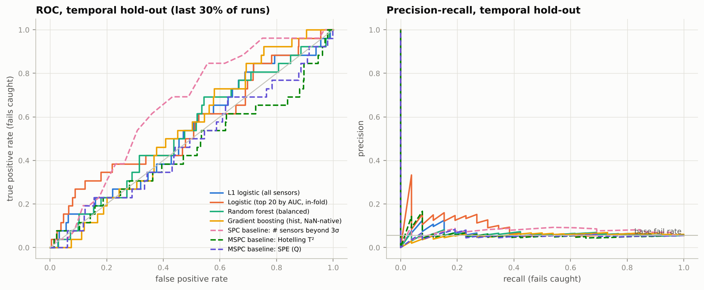
*Figure 10. ROC and precision-recall curves on the temporal hold-out.*

Under shuffled 10-fold cross-validation the same classifiers reach ROC AUC 0.70 to 0.76, PR AUC 0.14 to 0.19 and BER 0.28 to 0.32 (optimistic, since the threshold is tuned on the same predictions). These are close to the baseline published with the dataset, in which a kernel ridge classifier on 40 selected sensors achieved BER between 33.5 % and 40.1 % under 10-fold cross-validation (McCann and Johnston, 2008).

Walk-forward evaluation from the change point covers 831 runs and 37 failures (Table 6, Figure 11). Retraining before each block of 100 runs lifts the linear models from chance to about 0.56 to 0.59. Gradient boosting trained once on Phase I reaches 0.62 (0.52 to 0.70) and does not improve with retraining.

Table 6. Walk-forward evaluation after the change point (pooled ROC AUC).

| Model | Trained once | Retrained every 100 runs | Retrained on last 500 runs |
|---|---|---|---|
| Logistic, top 20 sensors | 0.424 | 0.559 | 0.554 |
| L1 logistic, all sensors | 0.493 | 0.592 | |
| Gradient boosting | 0.615 | 0.575 | |

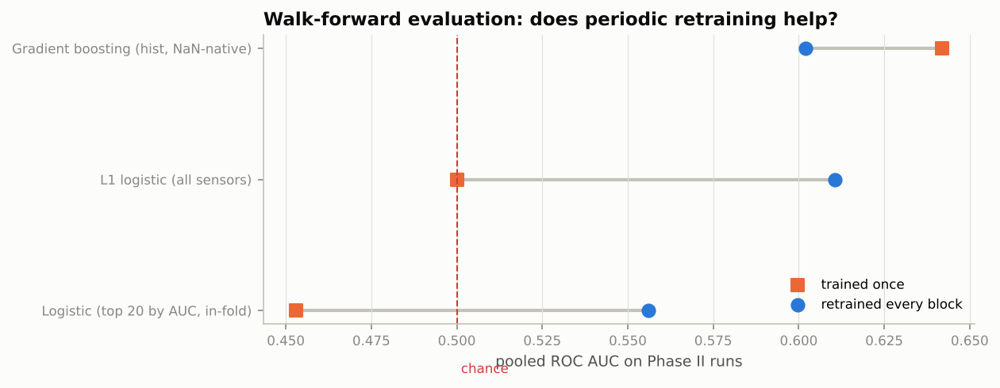
*Figure 11. Pooled walk-forward AUC for models trained once and retrained before each block.*

## 5. Discussion

The record contains one dominant event, a change on 7 September. Four observations point to an instrumentation change rather than a process change: seven sensors switch from held values to live readings around it; those sensors carry most of the post-change SPE; removing them brings the frozen monitor close to its nominal alarm rate; and the line-test pass rate improves rather than deteriorates. The data cannot establish the cause. The appropriate response is the same either way: re-baseline after the event, and check data quality before a sensor enters a control plan.

The operating figures in Table 3 make the cost concrete. Frozen limits would have generated about fifteen alarms per day for an engineer to dismiss, which in practice teaches people to ignore the monitor. Re-baselining or rolling limits keep the burden below one alarm per day. Rolling limits achieve this without knowing the change date, at the cost of absorbing slow drifts that a fixed baseline would expose.

The monitor detects process change, not product failure. No strategy flags failed runs at a higher rate than passing runs, and alarm days are not concentrated on high-fail days. This is consistent with the predictive results: the sensors carry little stable information about this line test. The few associations that survive the within-week and later-period checks (S021, S247, S033) are candidates for engineering follow-up rather than control-plan inputs.

Shuffled cross-validation overstated achievable performance by about 0.2 AUC on this dataset. Evaluating on later data, and retraining on a schedule, gives a more realistic view of how a failure-prediction model would behave in production.

### 5.1 Spotfire dashboard

The exported CSVs were loaded into a Spotfire analysis (Spotfire 15.1, data embedded in the file): [spotfire/SECOM_SPC_Dashboard.dxp](spotfire/SECOM_SPC_Dashboard.dxp). The four pages below reproduce the main monitoring views.

| Weekly line-test pass rate | Daily pass rate, 7-day rolling mean, change point (7 Sep) |
|---|---|
| 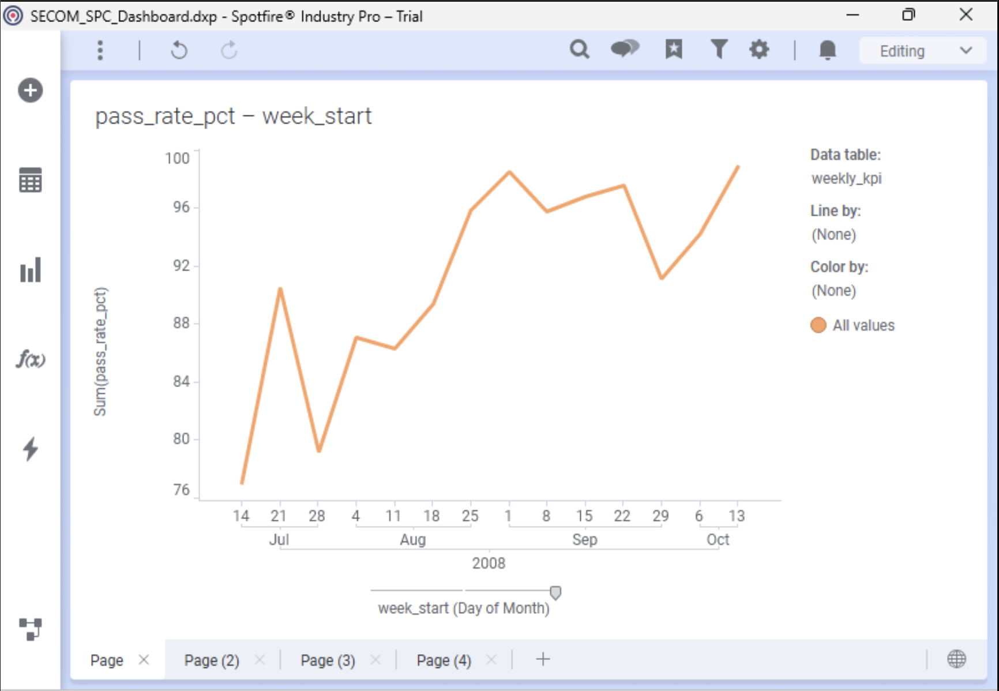 | 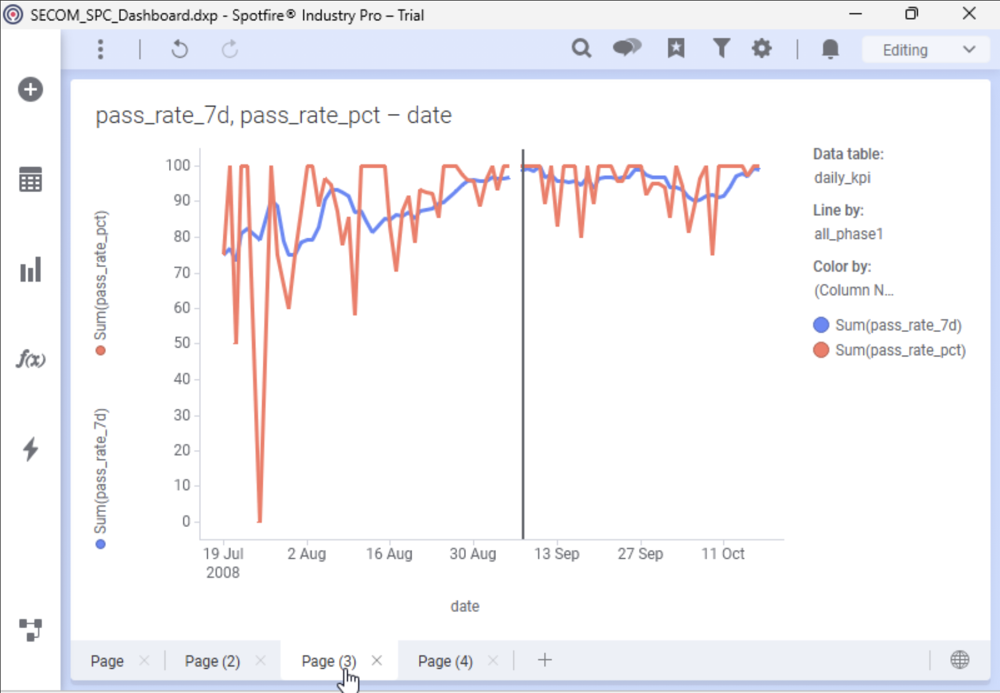 |
| **Daily failures, colored by p-chart out-of-control flag** | **Single-sensor AUC, sorted** |
| 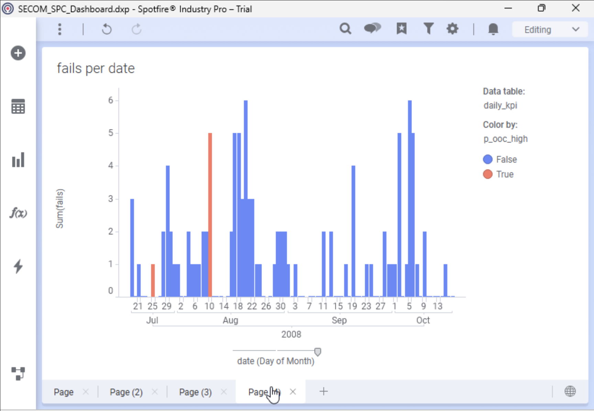 | 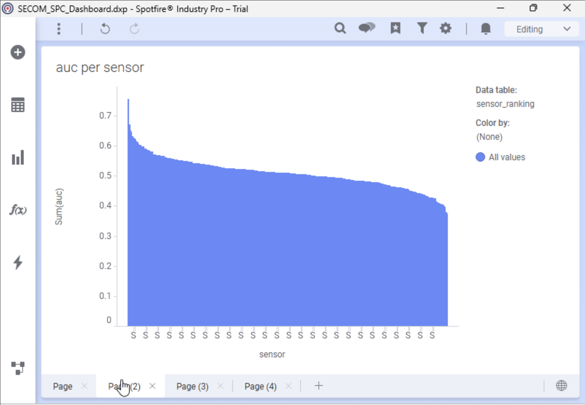 |

The rolling mean shows the pass rate stabilising near 95 to 100 percent after the detected change point. Two days exceed the binomial p-chart limit; the overdispersion-corrected Laney limits flag fewer. Most sensors sit near AUC 0.5, with a short tail of weakly informative sensors, consistent with Section 4.

### 5.2 JMP

[jmp/secom_spc.jsl](jmp/secom_spc.jsl) reads the exports directly from this repository and rebuilds the main views in JMP 19.

| I-MR charts by sensor, Phase I limits applied to Phase II | Hotelling T² and SPE by run, colored by result |
|---|---|
| 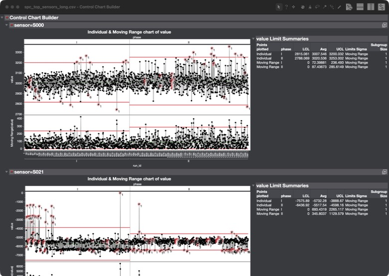 | 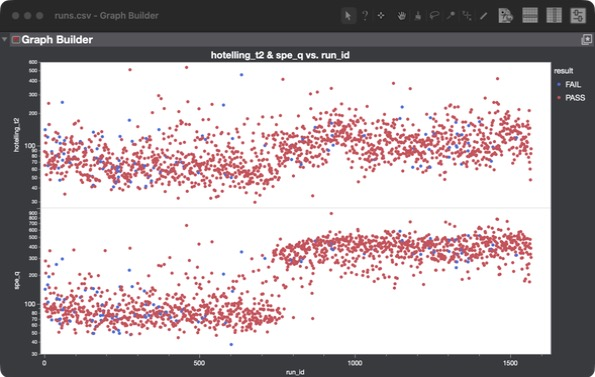 |
| **Daily pass rate and 7-day rolling mean** | **I-MR chart of daily failures** |
| 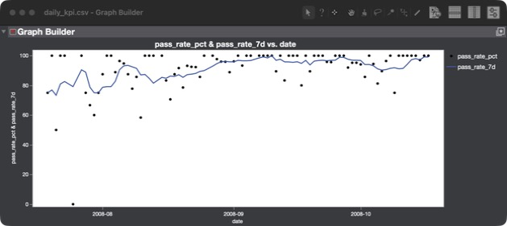 | 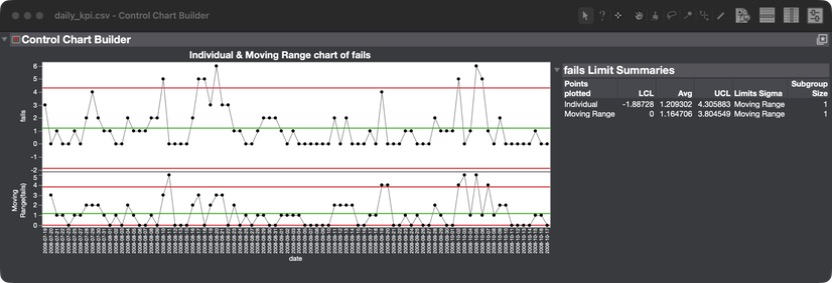 |

The SPE panel shows the step change near run 737 more clearly than any single sensor.

### 5.3 Interactive dashboard and walkthrough

The dashboard is live at [https://shim-1122.github.io/secom-spc/](https://shim-1122.github.io/secom-spc/); its source, [docs/index.html](docs/index.html), is a single self-contained HTML file (no server, no external libraries) with five pages: overview, multivariate monitor, alarm burden, sensors and per-sensor control charts. It is generated from the exports by `python scripts/build_dashboard.py` and gives the same views to a reader without Spotfire or JMP. The walkthrough video at the top of this page is rendered from the same exports by `python scripts/make_walkthrough.py`.

### 5.4 Excel and VBA

[excel/SECOM_SPC.xlsm](excel/SECOM_SPC.xlsm) is a macro-enabled workbook for readers who work in Excel. The module [excel/SECOM_SPC.bas](excel/SECOM_SPC.bas) adds two macros, run from Tools, Macro, Macros (Option+F8 on Mac):

- `RunSensorChart` sets individuals-chart limits from the Phase I runs (mean plus or minus 3 x mean moving range / 1.128) for the sensor in the yellow input cell, flags Nelson rules 1 to 3, counts alarm days and draws the chart on a `Chart` sheet.
- `RunRebaseline` compares alarms per day after the change point with frozen Phase I limits and with limits re-baselined on the first 200 runs after it.

For sensor S028 and change point run 737 the macro reports 4.52 alarms per day with frozen limits and 0.10 with re-baselined limits, the same figures as the Python code. Tested in Excel for Mac. `scripts/build_excel.py` rebuilds the data sheets from the exports.

## 6. Limitations

Sensor identities, units and specification limits are unknown, so no sensor can be interpreted physically and capability cannot be assessed. Without lot, wafer, tool or chamber identifiers, commonality analysis, often the first step in a real yield investigation, is not possible. The data contain 104 failures, 26 in the test partition and 28 in the monitoring period, so confidence intervals are wide and differences of a few hundredths in AUC are not meaningful. The outcome comes from a downstream test that may depend on steps not represented here. Runs are treated as independent, although autocorrelation is likely and would raise univariate alarm rates. The change point is estimated, not recorded; its plateau spans 4 to 9 September. The Spotfire dashboard (Section 5.1) covers four of the five pages in [docs/spotfire_dashboard.md](docs/spotfire_dashboard.md). The JMP script in [jmp/secom_spc.jsl](jmp/secom_spc.jsl) was run manually in JMP 19 (Section 5.2) but is not part of continuous integration.

### 6.1 What would change with production fab data

SECOM removes most of the context a yield or process engineer would start from. With access to that context, the analysis would proceed differently, in roughly this order.

1. **Confirm the change against equipment records.** The first question about 7 September is what happened on the tool. Maintenance logs, sensor replacements, recipe revisions and software updates would be checked against the date before any statistical conclusion is drawn. The four sensors in Figure 6b would be mapped to physical instruments.
2. **Commonality analysis before sensor models.** With lot, wafer, tool, chamber and recipe identifiers, the first test is whether failures concentrate on one tool, chamber or route. That usually explains more than any sensor ranking, and it cannot be done here.
3. **Baselines per tool, chamber and recipe.** One pooled baseline, as used here, mixes populations. Limits would be kept per context and re-baselined on a defined trigger, such as preventive maintenance or a qualified recipe change, instead of on a detected change point alone.
4. **Real specification limits.** Cp and Cpk would be computed against engineering specifications for named parameters. The proxy values in this repository are not capability estimates.
5. **A richer outcome.** A single pass or fail per run would be replaced with wafer-level or die-level yield, bin codes and inline metrology, so that a sensor excursion can be tied to a specific defect mode.
6. **An alarm budget agreed with the process owners.** The alarm-burden figures in Table 3 would become a design target: how many alarms per shift the team can investigate, which signals page someone and which only log, and what the out-of-control action plan is for each.
7. **Autocorrelation and within-lot structure.** Runs are treated as independent here. With lot structure known, limits would account for within-lot correlation and run-to-run control.

## 7. Reproducing the analysis

Python 3.10 or later is required. The raw data are included in `data/raw/`.

```bash
git clone https://github.com/Shim-1122/secom-spc.git
cd secom-spc
python -m pip install -e ".[dev]"
python -m secom_spc.pipeline          # full analysis, about 8 minutes
python -m secom_spc.pipeline --fast   # reduced bootstrap; no shuffled CV; about 2 minutes
pytest                                # 41 unit tests
python scripts/build_dashboard.py     # interactive dashboard, docs/index.html
python scripts/make_walkthrough.py    # walkthrough video and GIF (needs ffmpeg)
```

Every number in this document is written to `reports/summary.json` by the pipeline. Parameters (phase boundary rule, re-baselining and rolling windows, chart constants, PCA variance target, model settings) are defined in [src/secom_spc/config.py](src/secom_spc/config.py). Proxy-specification Cpk and Ppk values, which are not used in this report, are in `reports/tables/capability_proxy_specs.csv`.

### Repository structure

```text
src/secom_spc/
  config.py         analysis parameters
  data.py           loading, time ordering, partitions
  changepoint.py    label-free change-point estimation
  preprocess.py     sensor screening and imputation (fitted on Phase I)
  spc.py            I-MR, X-bar/S, p, Laney p', EWMA and CUSUM charts
  rules.py          Nelson rules 1 to 8
  multivariate.py   PCA monitoring: Hotelling T², SPE, out-of-fold limits, contributions
  monitoring.py     frozen, re-baselined and rolling monitors; alarm burden
  drift.py          shift and spread, adversarial validation, frozen sensors, within-week AUC
  capability.py     Cp, Cpk, Pp, Ppk (proxy specifications, supporting table only)
  features.py       sensor ranking criteria and consensus
  modeling.py       classifiers and the three evaluation protocols
  plots.py          figures
  pipeline.py       end-to-end analysis, one function per stage
tests/              unit tests: constants, run rules, change point, MSPC, leakage, confounding
docs/               methodology, Spotfire specification, interactive dashboard (index.html), walkthrough
scripts/            data download, dashboard builder, walkthrough renderer, Excel workbook builder
spotfire/           Spotfire analysis file
jmp/                JMP script that rebuilds the charts from the exports
excel/              Excel workbook (.xlsm) and VBA module for SPC limits, charts and re-baselining
reports/            figures, tables, dashboard exports and summary.json
data/raw/           the original UCI files
```

### Outputs for dashboards

`reports/exports/` contains tidy CSV files for Spotfire, JMP, Excel or a spreadsheet:

| File | One row per | Contents |
|---|---|---|
| `runs.csv` | run | outcome, phase, monitoring period, alarm counts, T², SPE, limits, alarm flags under each limit strategy, predicted fail probability |
| `daily_kpi.csv` | day | runs, fails, pass rate, rolling pass rate, p and Laney limits |
| `weekly_kpi.csv` | week | runs, fails, pass rate |
| `spc_top_sensors_long.csv` | run and sensor (top 20) | value, limits, z, moving range, EWMA, CUSUM, Nelson flags |
| `sensor_ranking.csv` | sensor | ranking criteria and robustness checks |
| `sensor_shift_spread.csv` | sensor | median shift, spread ratio and KS test between phases |
| `spe_contribution_by_phase.csv` | sensor | share of total SPE before and after the change point |

## References

Benjamini, Y., and Hochberg, Y. (1995). Controlling the false discovery rate. *Journal of the Royal Statistical Society B*, 57(1), 289-300.

Jackson, J. E., and Mudholkar, G. S. (1979). Control procedures for residuals associated with principal component analysis. *Technometrics*, 21(3), 341-349.

Laney, D. B. (2002). Improved control charts for attributes. *Quality Engineering*, 14(4), 531-537.

MacGregor, J. F., and Kourti, T. (1995). Statistical process control of multivariate processes. *Control Engineering Practice*, 3(3), 403-414.

McCann, M., and Johnston, A. (2008). SECOM [Dataset]. UCI Machine Learning Repository. https://doi.org/10.24432/C54305

Meinshausen, N., and Buehlmann, P. (2010). Stability selection. *Journal of the Royal Statistical Society B*, 72(4), 417-473.

Montgomery, D. C. (2019). *Introduction to Statistical Quality Control* (8th ed.). Wiley.

Nelson, L. S. (1984). The Shewhart control chart: Tests for special causes. *Journal of Quality Technology*, 16(4), 237-239.

## License

Code is released under the MIT License. The SECOM data are distributed by the UCI Machine Learning Repository under CC BY 4.0; see [data/README.md](data/README.md).
